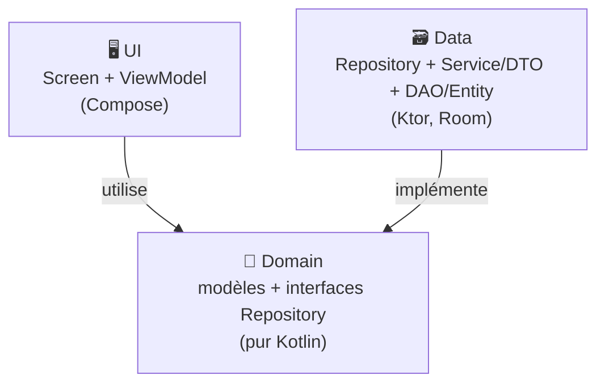
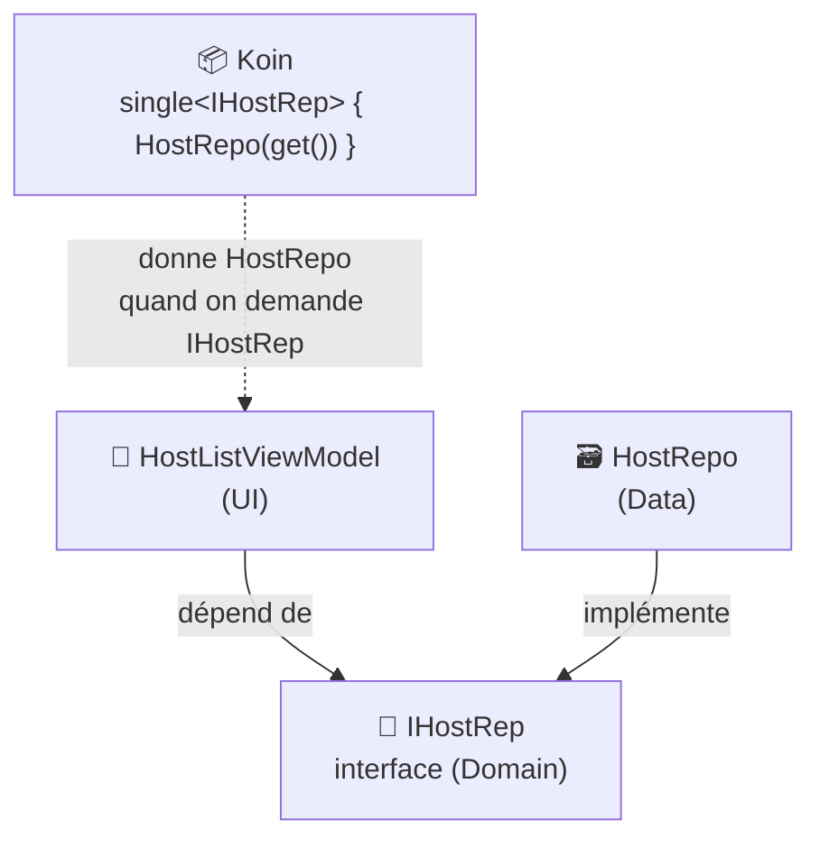
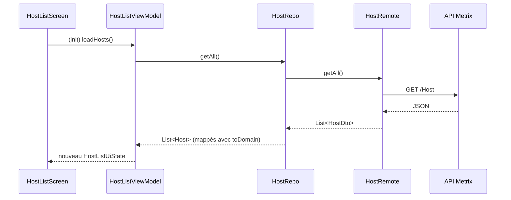

---
tags:
  - projet/kotlin
  - type/index
  - techno/kotlin
  - techno/android
  - techno/koin
  - sujet/architecture
  - sujet/clean-architecture
  - sujet/injection-de-dependances
  - statut/a-jour
cours: P1
cree: 2026-10-26
maj: 2026-10-26
---

# Architecture — la Clean Architecture

> [!abstract] En une phrase
> La **Clean Architecture** range l'app en **3 couches** : **UI** (afficher), **Domain** (le métier) et **Data** (les données). Les dépendances vont **toutes vers le Domain**, qui ne dépend de **rien**. À lire après [[05 Architecture (Screen - ViewModel - Model)]].

> [!note] Complété le 26 octobre 2026
> Section ajoutée à partir de la grille d'évaluation : 4 critères sur 15 portent sur la Clean Architecture et ses couches. Les exemples sont le **vrai code de Metrix**.

---

## 🧱 Les 3 couches



| Couche | Rôle | Contient | Connaît |
|---|---|---|---|
| **UI** (présentation) | **Afficher** et réagir aux actions | Screens, composables, ViewModels, UiState | le **Domain** |
| **Domain** (métier) | **Ce que l'app manipule** et ses règles | Modèles (`Host`), interfaces (`IHostRep`), use cases | **personne** |
| **Data** (accès aux données) | **Aller chercher** et **stocker** les données | Repositories, Services/DTO, DAO/Entity, mappers | le **Domain** |

> [!info] La règle de dépendance
> Les flèches pointent **vers l'intérieur**, vers le **Domain**. Le Domain ne fait **aucun `import`** de Compose, de Ktor, de Room ou d'Android : c'est du **Kotlin pur**.

### Et ton Screen / ViewModel / Model ?

Ta note [[05 Architecture (Screen - ViewModel - Model)]] décrit **la même idée**, en plus simple. Ton « **Model** » est **découpé en deux** :

| Ta note | Clean Architecture |
|---|---|
| **Screen** | UI |
| **ViewModel** | UI |
| **Model** : les données (`data class`) | **Domain** (les modèles) |
| **Model** : le repository | **Domain** (l'interface) + **Data** (l'implémentation) |
| **Model** : la source (API, base) | **Data** (Service/DTO, DAO/Entity) |

---

## 🎯 Pourquoi s'embêter

| Gain | Exemple concret |
|---|---|
| **Indépendance des frameworks** | On remplace Ktor par Retrofit : seule la couche **Data** change. Le Domain et l'UI ne bougent pas |
| **Testabilité** | Pour tester un ViewModel, on lui donne un **faux** repository (une liste écrite à la main) au lieu de la vraie API |
| **Maintenance** | Chaque classe a **un seul rôle** : on sait **où** chercher un bug |
| **Travail en équipe** | Un dev fait l'écran pendant qu'un autre fait l'API : ils se mettent d'accord sur l'**interface** du Domain |

---

## 🔌 Comment les couches se branchent : interface + Koin

Le **ViewModel** a besoin des hôtes, mais il ne doit **pas** dépendre de la couche Data. L'astuce : il dépend d'une **interface** du Domain, et **Koin** lui donne l'implémentation de la couche Data. C'est l'**inversion de dépendance**.



Vrai code de **Metrix** :

```kotlin
// domain/repository/IHostRep.kt : le contrat
interface IHostRep {
    suspend fun getAll(): List<Host>
    // …
}

// data/repository/HostRepository.kt : l'implémentation
class HostRepo(private val remote: HostRemote) : IHostRep {
    override suspend fun getAll(): List<Host> =
        remote.getAll().map { it.toDomain() }
}

// ui/screens/hostList/HostListViewModel.kt : ne connaît que l'interface
class HostListViewModel(private val hostRepository: IHostRep) : ViewModel()

// di/AppModule.kt : le branchement
single { HostRemote(get(named(AUTHENTICATED_API_CLIENT))) }
single<IHostRep> { HostRepo(get()) }
viewModelOf(::HostListViewModel)
```

| Code | Pourquoi |
|---|---|
| `interface IHostRep` | Le **contrat** : « je sais donner des hôtes ». Il est dans le **Domain** |
| `class HostRepo(...) : IHostRep` | La couche **Data** **remplit** le contrat |
| `HostListViewModel(private val hostRepository: IHostRep)` | Le ViewModel demande **le contrat**, pas `HostRepo` : il ne sait pas que ça vient d'une API |
| `single<IHostRep> { HostRepo(get()) }` | « Quand quelqu'un demande un `IHostRep`, donne-lui un `HostRepo` » |
| `viewModelOf(::HostListViewModel)` | Koin crée le ViewModel et remplit **tout seul** ses paramètres avec `get()` |

> [!success] Ce que la grille attend (SF-1)
> « L'étudiant a utilisé toute la boîte à outils (**Gradle**, **injection de dépendances**). **Koin** est parfaitement intégré, les couches sont parfaitement séparées. »

---

## 🔁 Le trajet complet d'une donnée



👉 Le **DTO** ne dépasse **jamais** le repository : à partir de là, tout le monde manipule le **modèle du Domain** (`Host`).

---

## 📚 Notes de la section

| Note | Contenu |
|---|---|
| [[01 La couche Domain]] | Modèles, interfaces Repository, use cases |
| [[02 La couche Data]] | Service/DTO, DAO/Entity, mapping, mécanisme de fetch |
| [[03 La couche UI (MVI et UDF)]] | État, actions, flux unidirectionnel, Single Activity |

---

## 🔗 Liens

- [[05 Architecture (Screen - ViewModel - Model)]] — la version simple, vue en cours
- [[09 Koin (injection de dépendances)]] — l'outil qui branche les couches
- [[10 Organisation du projet]] — les packages `ui/`, `domain/`, `data/`, `di/`
- [[kotlin]] — accueil du cours
