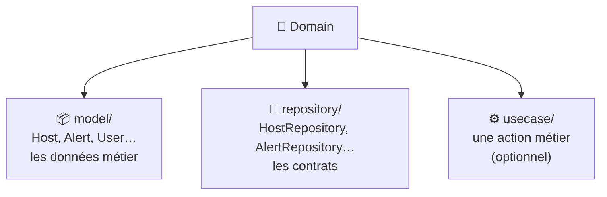

---
tags:
  - projet/kotlin
  - type/concept
  - techno/kotlin
  - sujet/architecture
  - sujet/clean-architecture
  - sujet/domain
  - statut/a-jour
cours: P1
cree: 2026-10-26
maj: 2026-10-28
---

# La couche Domain

> [!abstract] En une phrase
> Le **Domain**, c'est le **cœur métier** de l'app : **ce qu'elle manipule** (les modèles) et **ce qu'elle sait faire** (les contrats Repository), écrit en **Kotlin pur**, sans rien savoir de l'écran ni de l'API. Vue d'ensemble dans [[00 Architecture]].

> [!note] Complété le 26 octobre 2026
> Note ajoutée à partir de la grille d'évaluation (critères « couche Domain » : théorie, pratique, qualité). Les exemples sont le **vrai code de Metrix**.

---

## 💎 Ce qu'il y a dedans



| Élément | Rôle | Exemple Metrix |
|---|---|---|
| **Domain Model** | Décrit **une donnée métier**, telle que l'app la pense | `Host`, `Alert`, `UserRole` |
| **Interface Repository** | Le **contrat** : « je sais donner / créer / supprimer des hôtes » | `HostRepository` |
| **Use case** | **Une** action métier, quand elle contient une vraie règle | dossier `usecase/` (vide pour l'instant) |

> [!info] Kotlin pur
> Dans `domain/`, **aucun import** d'Android, de Compose, de Ktor, de Room, ni d'annotation `@Serializable`. Si tu en vois un, c'est qu'une logique **externe** s'est glissée dans le métier. Metrix respecte cette règle.

---

## 📦 Les Domain Models

Vrai code de **Metrix** (`domain/model/Host.kt`, raccourci) :

```kotlin
/**
 * Domain data returned for a host.
 *
 * @property id Host identifier.
 * @property name Display name of the host.
 * @property latestState Most recent measurement, or `null` when the host has none yet.
 * @property alerts Alerts associated with the host.
 */
data class Host(
    val id: Int,
    val name: String,
    val description: String,
    val isDisabled: Boolean,
    val latestState: HostState?,
    val hostStates: List<HostState>,
    val alerts: List<Alert>,
)
```

| Code | Pourquoi |
|---|---|
| `data class` | Une classe faite pour **porter des données** : `equals`, `copy`, `toString` sont générés |
| Que des `val` | Le modèle est **immuable** : on ne le modifie pas, on en crée un nouveau avec `copy` |
| `HostState?` | Le **métier** dit qu'un hôte peut ne pas avoir encore de mesure → `null` autorisé |
| `List<Alert>` (pas `List<AlertDto>`) | Le modèle ne contient **que des modèles du Domain**, jamais de DTO |
| Le KDoc `@property` | Explique le **sens métier** de chaque champ → [[05 KDoc et commentaires]] |

### Modèle du Domain ≠ DTO

| | **Domain Model** (`Host`) | **DTO** (`HostDto`) → [[03 La couche Data]] |
|---|---|---|
| Rangé dans | `domain/model/` | `data/dto/` |
| Suit | Ce dont **l'app** a besoin | La forme du **JSON** de l'API |
| Annotation | aucune | `@Serializable` |
| Si l'API change | ne bouge **pas** | change |

> [!tip] Un modèle pour écrire
> Metrix a aussi `HostInput` : **seulement les champs modifiables**, pour créer ou mettre à jour un hôte. L'`id` n'y est pas, puisque c'est l'API qui le donne.

---

## 📜 Les interfaces Repository

Vrai code de **Metrix** (`domain/repository/HostRepository.kt`, raccourci) :

```kotlin
/**
 * Contrat du domaine pour accéder aux hôtes et aux ressources associées.
 */
interface HostRepository {
    /** Récupère tous les hôtes. */
    suspend fun getAll(): List<Host>

    /**
     * Récupère un hôte à partir de son identifiant.
     *
     * @return L'hôte, ou `null` si l'API répond avec une erreur 404.
     */
    suspend fun getById(id: Int): Host?

    /** Crée un hôte et renvoie la représentation fournie par l'API. */
    suspend fun create(input: HostInput): Host

    /**
     * Supprime un hôte.
     *
     * @return `false` si l'hôte n'existe pas.
     */
    suspend fun delete(id: Int): Boolean
}
```

| Code | Pourquoi |
|---|---|
| `interface` | Un **contrat** sans code : il dit **quoi**, pas **comment**. Le « comment » est dans la couche Data |
| Rangée dans `domain/` | C'est le **métier** qui décide de ce dont il a besoin, pas l'API |
| `suspend` | Aller chercher des données **prend du temps** : la fonction peut attendre sans bloquer l'écran |
| Renvoie `Host`, reçoit `HostInput` | Le contrat ne parle **que** la langue du Domain |
| `Host?` / `Boolean` | Le cas « n'existe pas » fait partie du **contrat** : l'appelant sait quoi attendre |

> [!question] À confirmer avec le cours
> Le KDoc de `getById` parle d'« erreur **404** » : c'est un détail **HTTP**, donc de la couche Data. Pour un contrat 100 % métier, on écrirait plutôt « `null` si l'hôte n'existe pas ». À voir si le prof est aussi strict.

---

## ⚙️ Les use cases (optionnel)

Un **use case** = **une** action métier, dans **une** classe. On en crée un quand une **règle** mérite d'être **réutilisée** ou **testée** à part :

```kotlin
/**
 * Donne les hôtes à surveiller : les hôtes désactivés sont exclus.
 *
 * @property hostRepository la source des hôtes.
 */
class GetMonitoredHostsUseCase(private val hostRepository: HostRepository) {
    suspend operator fun invoke(): List<Host> =
        hostRepository.getAll().filter { !it.isDisabled }
}

// Dans un ViewModel
val hosts = getMonitoredHosts()
```

| Code | Pourquoi |
|---|---|
| Dépend de `HostRepository` | Le use case reste dans le Domain : il ne connaît que **l'interface** |
| `operator fun invoke()` | Permet d'appeler l'objet **comme une fonction** : `getMonitoredHosts()` |
| `filter { !it.isDisabled }` | La **règle métier**, écrite **une seule fois** |

> [!note] Pas obligatoire
> La grille parle de **Models** et de **Repositories**, pas de use cases. Si le ViewModel appelle juste `hostRepository.getAll()`, un use case qui ne fait que transmettre n'apporte rien.

---

## ✅ Ce que la grille attend (S-3, SF-3, SE-3)

> [!success] Pour viser « Maîtrisé »
> - Des **Domain Models** et des **interfaces Repository** **indépendants** des couches externes.
> - Le Domain ne **mélange** pas de logique UI ou Data.
> - Les composants complexes ont un **commentaire « header »** (KDoc) qui explique la **logique métier**, pas le code.
> - Savoir **expliquer** pourquoi l'indépendance du Domain rend l'app **maintenable** et **évolutive**.

---

## 🔗 Liens

- [[00 Architecture]] — les 3 couches et la règle de dépendance
- [[03 La couche Data]] — qui implémente les interfaces
- [[05 KDoc et commentaires]] — les commentaires « header »
