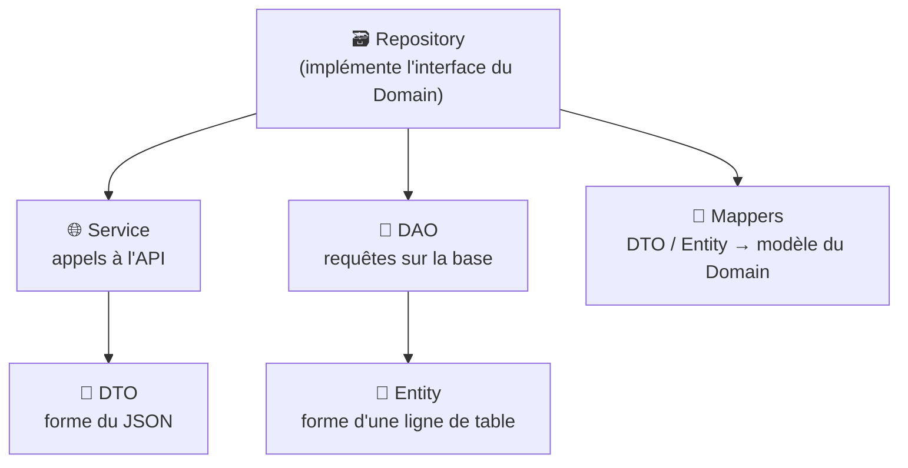
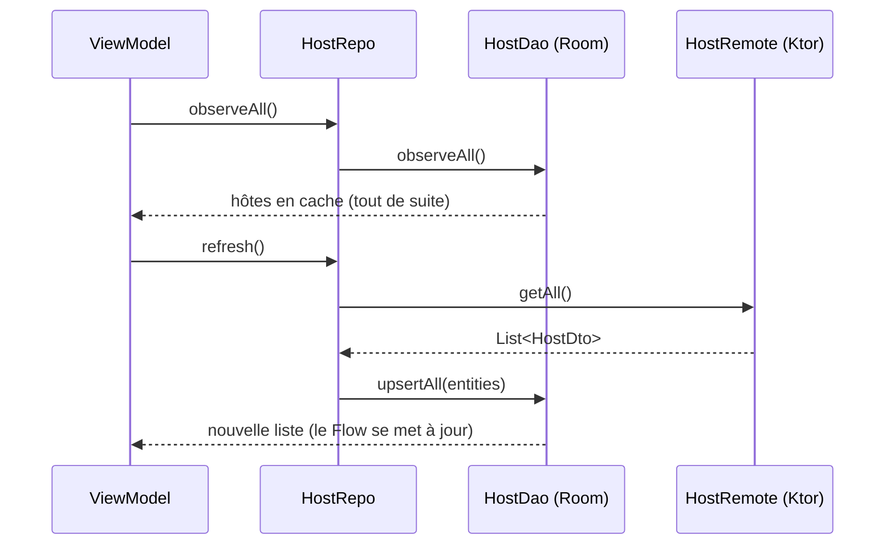

---
tags:
  - projet/kotlin
  - type/concept
  - techno/kotlin
  - techno/android
  - sujet/architecture
  - sujet/clean-architecture
  - sujet/data
  - statut/a-jour
cours: P1
cree: 2026-10-26
maj: 2026-10-26
---

# La couche Data

> [!abstract] En une phrase
> La couche **Data** sait **où** sont les données (une **API** distante, une **base** locale) et **comment** les récupérer. Elle **remplit les contrats** du [[02 La couche Domain|Domain]] et **traduit** tout en modèles du Domain avant de les rendre.

> [!note] Complété le 26 octobre 2026
> Note ajoutée à partir de la grille d'évaluation (critères « couche Data » : théorie, pratique, qualité). La partie **distante** est le vrai code de **Metrix** ; la partie **locale** (Room) est un exemple écrit pour la note, Metrix n'a pas de base locale.

---

## 🗃️ Les deux couples

La grille parle de **deux couples**, un par source de données :



| Couple | Source | Le premier… | Le second… |
|---|---|---|---|
| **Service / DTO** | **Distante** (API) | **Service** : fait les appels HTTP | **DTO** (*Data Transfer Object*) : la **forme du JSON** échangé |
| **DAO / Entity** | **Locale** (base Room) | **DAO** (*Data Access Object*) : fait les requêtes | **Entity** : la **forme d'une ligne** de table |

> [!tip] Dans Metrix
> Les **Services** s'appellent `…Remote` (`HostRemote`, `AlertRemote`), rangés dans `data/remote/`. Même rôle, autre nom.

---

## 🌐 Service / DTO (la source distante)

### Le DTO

Vrai code de **Metrix** (`data/dto/HostDto.kt`, raccourci) :

```kotlin
@Serializable
data class HostDto(
    val id: Int,
    val name: String,
    val description: String,
    val isDisabled: Boolean,
    val groupHostId: Int? = null,
    val latestState: HostStateDto? = null,
    val hostStates: List<HostStateDto> = emptyList(),
)
```

| Code | Pourquoi |
|---|---|
| `@Serializable` | **kotlinx.serialization** sait transformer le JSON en `HostDto` (et l'inverse) |
| Mêmes noms que le JSON | Le DTO **colle à l'API**, pas aux besoins de l'écran |
| `= null`, `= emptyList()` | Si l'API **oublie** un champ, pas de crash : on prend la valeur par défaut |

### Le Service

Vrai code de **Metrix** (`data/remote/HostRemote.kt`, raccourci) :

```kotlin
class HostRemote(
    private val httpClient: HttpClient,
) {
    /** Fetches all hosts. */
    suspend fun getAll(): List<HostDto> =
        httpClient.get("Host").body()

    /** Fetches a host, or returns `null` when the API responds with 404. */
    suspend fun getById(id: Int): HostDto? =
        httpClient.getBodyOrNull("Host/$id")
}
```

| Code | Pourquoi |
|---|---|
| `HttpClient` en paramètre | Le client **Ktor** est fourni par Koin, déjà configuré (adresse de l'API, jeton) |
| `httpClient.get("Host").body()` | Fait le `GET /Host` et **transforme** le JSON en `List<HostDto>` |
| Renvoie des **DTO** | Le Service ne connaît **pas** le Domain : il parle la langue de l'API |
| `getBodyOrNull(...)` | Une **fonction d'extension** maison de Metrix → [[04 Les fonctions d'extension]] |

---

## 💾 DAO / Entity (la source locale)

> [!example] Exemple écrit pour la note
> Pour rester court, imagine un `Host` réduit à `id`, `name` et `isDisabled`.

```kotlin
@Entity(tableName = "hosts")
data class HostEntity(
    @PrimaryKey val id: Int,
    val name: String,
    val isDisabled: Boolean,
)

@Dao
interface HostDao {
    @Query("SELECT * FROM hosts ORDER BY name")
    fun observeAll(): Flow<List<HostEntity>>

    @Upsert
    suspend fun upsertAll(hosts: List<HostEntity>)
}

@Database(entities = [HostEntity::class], version = 1)
abstract class MetrixDatabase : RoomDatabase() {
    abstract fun hostDao(): HostDao
}
```

| Code | Pourquoi |
|---|---|
| `@Entity(tableName = "hosts")` | Cette classe = **une ligne** de la table `hosts` |
| `@PrimaryKey` | La **clé** qui identifie chaque ligne |
| `@Dao interface` | On écrit **seulement** les requêtes : **Room génère** le code |
| `Flow<List<HostEntity>>` | La liste est **observée** : dès que la table change, une nouvelle liste arrive |
| `@Upsert` | **Insère** les lignes nouvelles, **met à jour** celles qui existent |
| `@Database(...)` | Déclare la base et ses tables. Créée avec `Room.databaseBuilder(androidContext(), …)` dans Koin |

> [!warning] Room demande KSP
> Room génère du code à la compilation : il faut le plugin **KSP** et les dépendances `room-runtime`, `room-ktx` et `room-compiler` (en `ksp(...)`). Voir [[02 Ajouter une dépendance]] pour la méthode.

---

## 🔄 Le mapping

Le **mapper** traduit un objet d'une couche en objet d'une autre. Metrix les écrit en **fonctions d'extension**, dans `data/mapper/ApiDtoMapper.kt` :

```kotlin
internal fun HostDto.toDomain(): Host = Host(
    id = id,
    name = name,
    description = description,
    isDisabled = isDisabled,
    // …
    latestState = latestState?.toDomain(),
    hostStates = hostStates.map(HostStateDto::toDomain),
)
```

| Code | Pourquoi |
|---|---|
| `fun HostDto.toDomain()` | On **ajoute** une fonction au DTO sans le modifier : `dto.toDomain()` se lit comme une phrase |
| `internal` | Visible **seulement dans le module** : le mapping est un détail de la couche Data |
| `latestState?.toDomain()` | On mappe **aussi** les objets imbriqués : aucun DTO ne doit fuiter |

Les mappers qu'on trouve en général :

| Mapper | Sert à |
|---|---|
| `HostDto.toDomain()` | API → Domain |
| `HostEntity.toDomain()` | Base → Domain |
| `HostDto.toEntity()` | API → Base (pour **mettre en cache**) |
| `HostInput.toCreateDto()` | Domain → API (pour **envoyer**) |

---

## 🔁 Le mécanisme de fetch

Le **Repository** décide **d'où** viennent les données. Deux façons de faire :

### 1. Distant seulement (Metrix aujourd'hui)

```kotlin
class HostRepo(private val remote: HostRemote) : IHostRep {
    override suspend fun getAll(): List<Host> =
        remote.getAll().map { it.toDomain() }
}
```

Simple, mais **sans réseau = écran vide**.

### 2. Local d'abord (*offline-first*)

La **base locale** devient la **seule source de vérité** : l'écran lit **toujours** la base, et l'API sert à la **rafraîchir**.

```kotlin
class HostRepo(
    private val remote: HostRemote,
    private val dao: HostDao,
) : IHostRep {

    // L'écran lit toujours la base : il affiche les dernières données connues, même hors ligne.
    override fun observeAll(): Flow<List<Host>> =
        dao.observeAll().map { entities -> entities.map { it.toDomain() } }

    // On récupère les données fraîches, puis on les range en base :
    // le Flow ci-dessus prévient l'écran tout seul.
    override suspend fun refresh() {
        val dtos = remote.getAll()
        dao.upsertAll(dtos.map { it.toEntity() })
    }
}
```



| Code | Pourquoi |
|---|---|
| `observeAll(): Flow<List<Host>>` | Le ViewModel **s'abonne** : il reçoit une nouvelle liste à chaque changement en base |
| `.map { … toDomain() }` | Ce qui sort du Repository, ce sont des **modèles du Domain** |
| `refresh()` | Va sur l'API **et range** le résultat en base. Il ne renvoie rien : c'est le Flow qui prévient |

> [!info] `Flow` dans le Domain ?
> L'interface du Domain renvoie un `Flow` : c'est autorisé, `Flow` vient de **kotlinx.coroutines** (du Kotlin), pas d'Android.

---

## 🚦 Ce qui transite entre les couches

| Objet | Né dans | Ne sort **jamais** de |
|---|---|---|
| `HostDto` | `data/remote/` (le JSON) | la couche **Data** |
| `HostEntity` | `data/local/` (la base) | la couche **Data** |
| `Host` | le **mapper** | — il circule partout : Domain, ViewModel, Screen |

> [!success] Ce que la grille attend (S-2, SF-4, SE-1)
> - Les couples **DAO/Entity** et **Service/DTO** sont **bien séparés**.
> - Le **mécanisme de fetch** entre source locale et distante est **cohérent**.
> - Les **mappers** entre les couches sont **implémentés**.
> - Fonctions et services **commentés** (KDoc), **pas de duplication**, **noms explicites**.

---

## 🔗 Liens

- [[00 Architecture]] — les 3 couches
- [[02 La couche Domain]] — les contrats que la couche Data remplit
- [[04 La couche UI (MVI et UDF)]] — qui consomme les données
- [[04 Les fonctions d'extension]] — la technique des mappers
