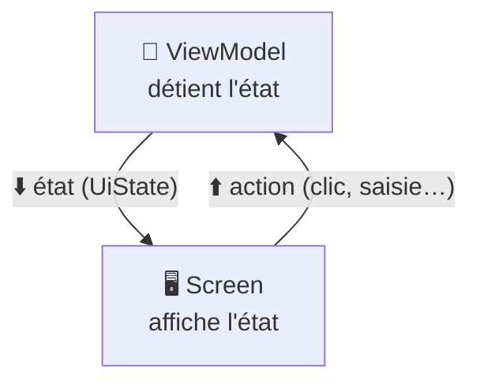
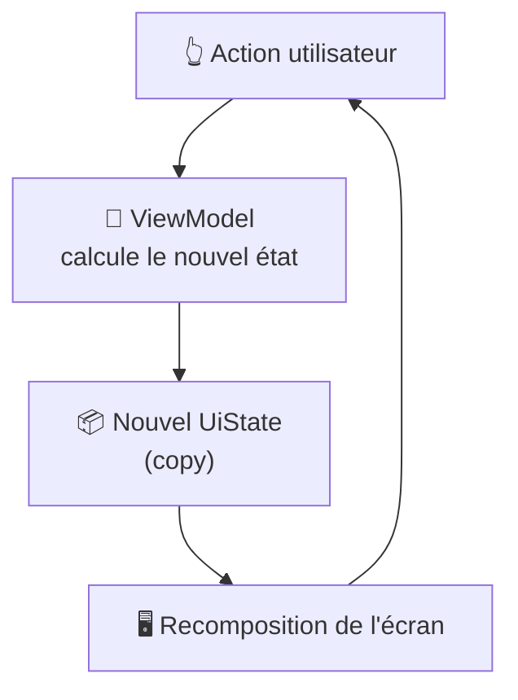
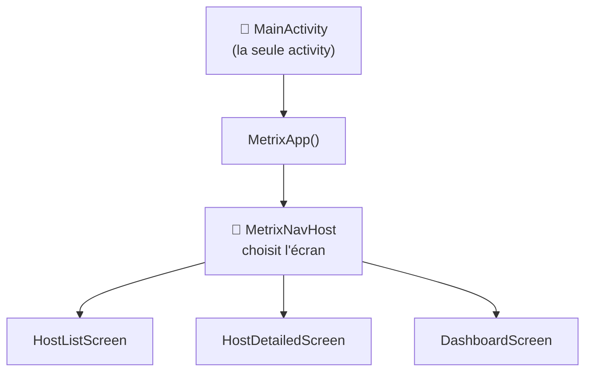

---
tags:
  - projet/kotlin
  - type/concept
  - techno/kotlin
  - techno/android
  - techno/compose
  - sujet/architecture
  - sujet/clean-architecture
  - sujet/mvi
  - sujet/etat
  - sujet/navigation
  - statut/a-jour
cours: P1
cree: 2026-10-26
maj: 2026-10-26
---

# La couche UI : MVI et UDF

> [!abstract] En une phrase
> Dans la couche **UI**, l'**état** descend du ViewModel vers l'écran, et les **actions** de l'utilisateur remontent de l'écran vers le ViewModel : c'est le **flux unidirectionnel** (**UDF**), et **MVI** est la façon de l'organiser. À lire après [[07 UI déclarative]] et [[00 Architecture]].

> [!note] Complété le 26 octobre 2026
> Note ajoutée à partir de la grille d'évaluation (critère « couche UI et Jetpack Compose » : MVI, UDF, gestion des états, Single Activity, navigation). Les exemples sont le **vrai code de Metrix**, sauf la version « MVI stricte ».

---

## 🔁 UDF : l'état descend, les actions remontent

> [!example] Le serveur au restaurant
> L'écran, c'est le **client** : il **regarde** son assiette (l'**état**) et **passe commande** (une **action**). Il ne va **jamais** en cuisine. Le ViewModel, c'est la **cuisine** : il reçoit la commande, prépare, et renvoie une **nouvelle assiette**.



| Sens | Ce qui circule | Comment |
|---|---|---|
| ⬇️ **Descend** | L'**état** (`UiState`) | Un `StateFlow` lu par l'écran |
| ⬆️ **Remonte** | Les **actions** de l'utilisateur | Des **lambdas** (`onRetry`, `onHostClick`…) |

> [!info] Pourquoi « unidirectionnel »
> L'état n'est modifié qu'à **un seul endroit** : le ViewModel. L'écran ne fait **jamais** `state.isLoading = false` lui-même. Résultat : quand un bug d'affichage arrive, on sait **où** chercher.

---

## 🧩 MVI : Model – View – Intent

| Lettre | Veut dire | Dans le code |
|---|---|---|
| **M**odel | L'**état** de l'écran | `data class HostListUiState` |
| **V**iew | L'**écran** qui affiche cet état | `HostListScreen` (composable) |
| **I**ntent | Une **intention** de l'utilisateur | « réessayer », « filtrer »… |

> [!warning] Intent ≠ Intent
> Le « **I** » de MVI n'a **rien à voir** avec l'[[10 Les Intents|Intent d'Android]]. Pour éviter la confusion, beaucoup de projets l'appellent **Action** ou **Event**.



---

## 📦 L'état (UiState)

Vrai code de **Metrix** (`HostListViewModel.kt`, raccourci) :

```kotlin
data class HostListUiState(
    val hosts: List<Host> = emptyList(),
    val isLoading: Boolean = true,
    @StringRes val errorMessage: Int? = null,
    /** Statuts cochés ; vide = tous les hôtes. */
    val selectedStatuses: Set<HostStatusFilter> = emptySet(),
) {
    /** Hôtes à afficher, après filtres et tri. */
    val visibleHosts: List<Host> = hosts.filterAndSort(/* … */)
}
```

| Code | Pourquoi |
|---|---|
| **Une** `data class` pour tout l'écran | L'écran entier se décrit avec **un seul objet** : facile à lire, à tester, à prévisualiser |
| Que des `val` + valeurs par défaut | **Immuable** : on n'en modifie pas un, on en crée un nouveau. `HostListUiState()` = l'état de départ |
| `isLoading`, `errorMessage` | L'état contient **ce que l'écran doit montrer** (un chargement, une erreur), pas juste les données |
| `visibleHosts` calculé | Le filtrage est fait **une fois**, dans l'état, et pas dans le composable |

> [!success] Ce que la grille attend
> « Le **State** est bien formé et contient des informations relatives à la **représentation visuelle** de données. »

---

## 🔗 Le ViewModel

Vrai code de **Metrix** (raccourci) :

```kotlin
class HostListViewModel(
    private val hostRepository: IHostRep,
) : ViewModel() {

    private val _uiState = MutableStateFlow(HostListUiState())
    val uiState: StateFlow<HostListUiState> = _uiState.asStateFlow()

    init {
        loadHosts()
    }

    fun loadHosts() {
        _uiState.update { it.copy(isLoading = true, errorMessage = null) }
        viewModelScope.launch {
            val hosts = hostRepository.getAll()
            _uiState.update { it.copy(hosts = hosts, isLoading = false) }
        }
    }

    /** Remet le tri et les filtres par défaut. */
    fun resetFilters() { /* … */ }
}
```

| Code | Pourquoi |
|---|---|
| `IHostRep` en paramètre | Le ViewModel dépend du **Domain**, pas de la couche Data → [[00 Architecture]] |
| `_uiState` **privé** et **modifiable** | Seul le ViewModel peut **changer** l'état |
| `uiState` **public** en `StateFlow` | L'écran peut seulement le **lire** : c'est l'UDF dans le code |
| `init { loadHosts() }` | On charge dès la création. Le ViewModel **survit à la rotation** → pas de rechargement ([[13 Le cycle de vie en pratique]]) |
| `_uiState.update { it.copy(...) }` | On crée un **nouvel état** à partir de l'ancien, en ne changeant que ce qui bouge |
| `viewModelScope.launch` | Lance l'appel réseau **sans bloquer** l'écran. Annulé tout seul si le ViewModel est détruit |
| `loadHosts`, `resetFilters` | Les **actions** ont des noms de **verbes** clairs (la grille le demande) |

### La version « MVI stricte »

Metrix expose **une fonction par action**. Une version MVI plus stricte n'a **qu'une seule porte d'entrée** :

```kotlin
sealed interface HostListAction {
    data object Retry : HostListAction
    data class ToggleStatus(val status: HostStatusFilter) : HostListAction
    data object ResetFilters : HostListAction
}

// Dans le ViewModel
fun onAction(action: HostListAction) {
    when (action) {
        HostListAction.Retry -> loadHosts()
        is HostListAction.ToggleStatus -> toggleStatus(action.status)
        HostListAction.ResetFilters -> resetFilters()
    }
}
```

| Code | Pourquoi |
|---|---|
| `sealed interface HostListAction` | La **liste fermée** de tout ce que l'utilisateur peut faire sur cet écran |
| `data object` / `data class` | Une action **sans** donnée / **avec** une donnée |
| `fun onAction(...)` + `when` | **Une seule** porte d'entrée. Le `when` oblige à traiter **toutes** les actions |

> [!question] À confirmer avec le cours
> Les deux versions respectent l'UDF. Vérifie si le prof attend la `sealed interface` d'actions (MVI strict) ou si une fonction par action lui va.

---

## 🖥️ L'écran

Vrai code de **Metrix** (`HostListScreen.kt`, raccourci) :

```kotlin
@Composable
fun HostListScreen(
    onHostClick: (Int) -> Unit,
    modifier: Modifier = Modifier,
    viewModel: HostListViewModel = koinViewModel(),
) {
    val state by viewModel.uiState.collectAsState()

    HostListScreenContent(
        state = state,
        onRetry = viewModel::loadHosts,
        onHostClick = onHostClick,
        // …
    )
}
```

| Code | Pourquoi |
|---|---|
| `koinViewModel()` | Koin fournit le ViewModel, avec ses dépendances |
| `collectAsState()` | Transforme le `StateFlow` en **état Compose** : à chaque nouvel état, **recomposition** |
| `HostListScreenContent(state, …)` | L'affichage est dans un composable **séparé** qui reçoit tout en paramètres : il est **prévisualisable** ([[04 Les previews]]) |
| `onRetry = viewModel::loadHosts` | L'action **remonte** par une lambda |
| `onHostClick: (Int) -> Unit` | L'écran ne connaît **pas** le `navController` : il dit juste « on a cliqué sur l'hôte 12 » |

> [!tip] `collectAsStateWithLifecycle()`
> Variante recommandée par Google : elle **arrête** de lire le flux quand l'app passe en arrière-plan. Elle demande `lifecycle-runtime-compose`.

### L'état local de l'écran

Tout n'a pas besoin d'aller dans le ViewModel. Un état **purement visuel** (un menu ouvert ou fermé) peut rester dans le composable :

```kotlin
var expanded by remember { mutableStateOf(false) }
```

| Outil | Garde la valeur… |
|---|---|
| `remember { mutableStateOf(...) }` | entre deux **recompositions** |
| `rememberSaveable { mutableStateOf(...) }` | **et** après une **rotation** |
| `StateFlow` dans le ViewModel | **et** tant que l'écran existe dans la navigation |

---

## 🧭 Single Activity et navigation

**Une seule activity** (`MainActivity`) sert de **conteneur**. Les écrans sont des **composables**, et le **NavHost** choisit lequel afficher → construction pas à pas dans [[03 MainActivity]].



| Pourquoi une seule activity | |
|---|---|
| **Navigation** plus simple | Changer d'écran = changer de route, pas lancer un [[10 Les Intents\|Intent]] |
| **Partage** facile | Le thème, la navbar, Koin sont posés **une fois** |
| **Cycle de vie** plus simple | Un seul cycle de vie d'activity à gérer |

---

## 🧱 Découper en Lego

La grille demande des composables « découpés conformément à la **philosophie des LEGOs** » ([[00 Compose]]). Dans Metrix :

| Niveau | Exemple | Rangé dans |
|---|---|---|
| **Screen** (avec ViewModel) | `HostListScreen` | `ui/screens/hostList/` |
| **Content** (sans ViewModel) | `HostListScreenContent` | `ui/screens/hostList/` |
| **Composant réutilisable** | `MetrixHostCard`, `MetrixFilterBar` | `ui/core/components/` |

> [!success] Ce que la grille attend (S-4 et SE-2)
> - Écrans **bien nommés**, composants **au bon endroit**, découpage **Lego**.
> - **Actions du ViewModel** nommées de façon **claire**.
> - **State** bien formé.
> - **Un composant complexe** avec un **KDoc** et des block tags → [[06 KDoc et commentaires]].
> - Savoir **schématiser** MVI / UDF (les schémas de cette note).

---

## 🔗 Liens

- [[00 Architecture]] — où se place la couche UI
- [[07 UI déclarative]] — l'état et la recomposition
- [[03 MainActivity]] — la Single Activity en pratique
- [[04 Les previews]] — pourquoi séparer Screen et Content
