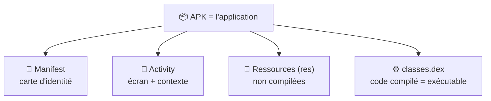
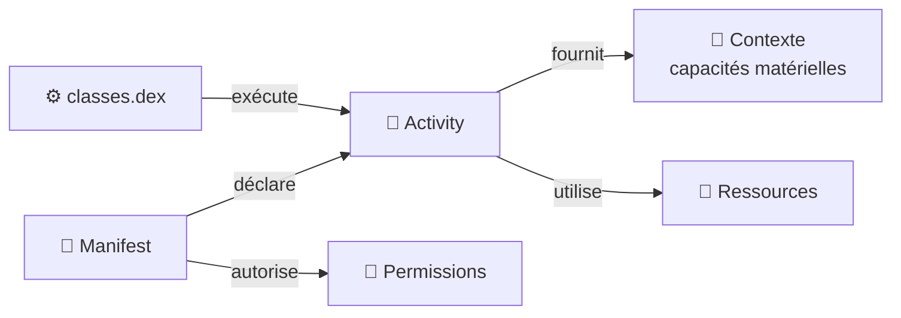

---
tags:
  - projet/kotlin
  - type/index
  - techno/kotlin
  - techno/android
  - sujet/apk
  - statut/a-jour
cours: P1
cree: 2026-09-28
maj: 2026-10-27
---

# Les composants de base d'une application Android

> [!abstract] En une phrase
> Une **application** Android est livrée sous forme d'**APK**. À l'intérieur de cet APK on trouve le **manifest**, les **activities** (+ leur contexte), les **ressources** et le **`classes.dex`** (le code compilé).

---

## 📦 À l'intérieur d'un APK (app)

| Composant | Rôle (résumé) | Note détaillée |
|---|---|---|
| **Manifest** | Carte d'identité : **nom de l'app**, **permissions** (ex. vibration), **activity principale** | [[01 Le manifest]] |
| **Activity** | Un **écran** ; fournit aussi un **contexte** (accès aux capacités matérielles) | [[02 Les Activities]] |
| **Ressources (`res`)** | **Non compilées** : images, sons, gifs, couleurs, strings (multilingue) | [[04 Les Ressources]] |
| **`classes.dex`** | Le **code compilé**, la **partie exécutable** de l'app | [[05 Classes.dex]] |

---

## 🗂️ Les sous-dossiers

### 1️⃣ L'app

| Note | Rôle |
|---|---|
| [[01 Le manifest]] | La carte d'identité de l'app |
| [[02 Les Activities]] | Un écran, qui est aussi un contexte |
| [[03 Le cycle de vie]] | Les 4 états, quoi faire à quelle étape, la rotation |
| [[04 Les Ressources]] | Le répertoire `res` et la reconfiguration |
| ↳ [[4.1 Les ressources en pratique]] | `stringResource`, variantes (langue, nuit), nommage |
| [[05 Classes.dex]] | Le code compilé / exécutable |
| [[06 Organisation du projet]] | Les dossiers du projet et les packages par couche |

### 2️⃣ Système et matériel

| Note | Rôle |
|---|---|
| [[01 Le Context]] | Le guichet vers le système (Application vs Activity) |
| [[02 Les Intents]] | Le message « je veux faire ça » envoyé à Android |
| [[03 Les Permissions]] | Ce que l'app a le droit de faire : normale ou dangereuse |
| [[04 Les capacités natives (Managers)]] | Vibreur, capteurs, son… rangés dans des Managers |
| ↳ [[4.1 Le vibreur pas à pas]] | Ajouter le vibreur de A à Z (permission normale) |
| ↳ [[4.2 La localisation pas à pas]] | Ajouter le GPS de A à Z (permission dangereuse, popup) |

> [!info] Ce qui est rangé ailleurs
> - Screen / ViewModel / Model et **Koin** → dossier **Architecture** : [[01 Architecture (Screen - ViewModel - Model)]], [[05 Koin (injection de dépendances)]]
> - **UI déclarative** → dossier **Compose** : [[01 UI déclarative]]
> - **Fonction d'extension**, KDoc, Lint → dossier **Code** : [[04 Les fonctions d'extension]]

---

## 🔗 Comment ça s'articule

---

## ➡️ Suite

Commence par [[01 Le manifest]], puis suis les sous-dossiers dans l'ordre (1 → 2).
