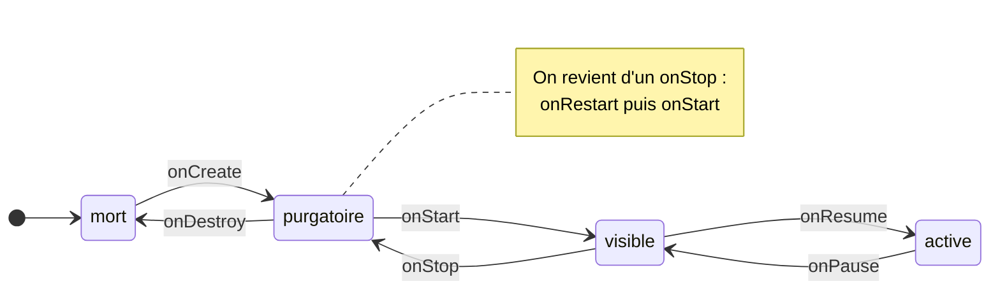
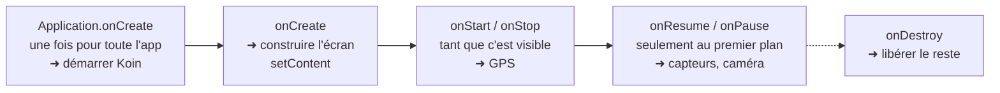
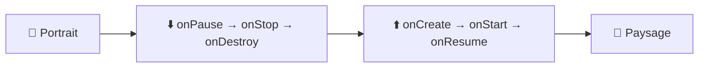

---
tags:
  - projet/kotlin
  - type/concept
  - techno/kotlin
  - techno/android
  - techno/compose
  - sujet/cycle-de-vie
  - sujet/activity
  - statut/a-jour
cours: P1
cree: 2026-10-26
maj: 2026-10-26
---

# Le cycle de vie

> [!abstract] En une phrase
> Une [[02 Les Activities|activity]] passe par **4 états** (mort → purgatoire → visible → active), reliés par des **callbacks** qui vont **par paires**. Ce qu'on allume dans un callback, on l'éteint dans son symétrique.

---

## 🧭 Les 4 états

À l'oral, donne **les deux** : tes mots montrent que tu as compris, les mots officiels (`Lifecycle.State`) montrent que tu connais Android.

| Tes mots | Officiel | Ce que ça veut dire |
|---|---|---|
| **mort** | `DESTROYED` | L'activity n'existe pas (ou plus). |
| **purgatoire** | `CREATED` | Elle est « morte » mais **survit légèrement** : elle peut encore envoyer des notifications et **garder un certain contexte**. L'app est en **arrière-plan**. |
| **visible** | `STARTED` | Elle est **affichée** mais **pas au premier plan** (ex. un dialogue par-dessus, écran partagé). Ce n'est **pas** l'arrière-plan. |
| **active** | `RESUMED` | Elle est **au premier plan**, l'utilisateur interagit avec. |



> [!tip] Lire le schéma
> On **monte** avec `onCreate → onStart → onResume` et on **descend** avec `onPause → onStop → onDestroy`. Chaque montée a **sa descente** : `onCreate ↔ onDestroy`, `onStart ↔ onStop`, `onResume ↔ onPause`.

---

## 🎯 Quoi faire à quelle étape



> [!info] La règle des paires
> Un capteur allumé dans `onResume` et jamais éteint dans `onPause` continue de tourner app fermée et **vide la batterie**.

Exemple réel, **Metrix** : Koin démarre dans `Application.onCreate`, appelé **une seule fois**, **avant** toute activity.

```kotlin
class MetrixApplication : Application() {
    override fun onCreate(){
        super.onCreate()
        startKoin {
            androidContext(this@MetrixApplication) // l'Application Context
            modules(appModule)
        }
    }
}
```

---

## 🔄 La rotation : l'activity est recréée

**Par défaut**, un changement de configuration (rotation, mode nuit, langue) **détruit l'activity et la recrée**. Ce n'est pas un simple pause / resume : on refait **tout** le cycle → [[04 Les Ressources#Reconfiguration cycle de vie complet]].



Pourquoi aussi brutal : en paysage ou en mode nuit il faut peut-être **d'autres ressources** (`values-night/`, `layout-land/`). Le plus simple pour Android, c'est de tout reconstruire.

| Où est la donnée | Survit à la rotation ? |
|---|---|
| Variable dans l'activity | ❌ perdue |
| `remember { }` dans un composable | ❌ perdue |
| `rememberSaveable { }` | ✅ sauvegardée puis restaurée |
| **ViewModel** | ✅ **il survit** : c'est une de ses raisons d'exister |

> [!example] Exemple réel
> Dans Metrix, `HostListViewModel` charge les hôtes dans son `init { loadHosts() }`. Le ViewModel survit à la rotation, donc **on ne recharge pas** la liste en tournant le téléphone.

> [!note] L'exception `configChanges`
> Dans le [[01 Le manifest|manifest]], `android:configChanges="orientation|screenSize"` sur une activity empêche la recréation : Android appelle juste `onConfigurationChanged()` et c'est toi qui gères. La doc Android le **déconseille** sauf cas précis (lecteur vidéo).
> Pour vérifier la règle par défaut : un `Log.d` dans `onCreate` et `onDestroy`, puis tourne l'émulateur → les deux s'affichent.

---

## 🎨 En Compose (Single Activity)

L'écran est un **composable**, pas une activity. Compose a ses propres outils :

| Outil | Se déclenche… | Exemple |
|---|---|---|
| `LaunchedEffect(clé)` | quand l'écran **apparaît**, et à chaque changement de **clé** | Metrix : `LaunchedEffect(refreshAfterReturn) { viewModel.loadHosts() }` |
| `DisposableEffect(clé)` | à l'apparition, avec un `onDispose { }` à la **disparition** | S'abonner / se désabonner |
| `LifecycleResumeEffect(clé)` | à **`onResume`** / **`onPause`** de l'activity | Capteurs, caméra |

```kotlin
@Composable
fun CompassScreen(viewModel: CompassViewModel = koinViewModel()) {
    // Cycle de vie : la boussole n'écoute le gyroscope que quand l'écran est au
    // premier plan (ON_RESUME), et s'arrête dès qu'il passe en arrière-plan
    // (ON_PAUSE) ou qu'on quitte l'écran : on économise la batterie.
    LifecycleResumeEffect(Unit) {
        viewModel.startCompass()
        onPauseOrDispose { viewModel.stopCompass() }
    }

    val state by viewModel.uiState.collectAsStateWithLifecycle()
    CompassContent(state = state)
}
```

| Code | Pourquoi |
|---|---|
| `viewModel.startCompass()` | L'écran **ne touche pas** au capteur : il prévient le ViewModel, qui parle au Manager → [[04 Les capacités natives (Managers)]] |
| `collectAsStateWithLifecycle()` | Lit l'état **seulement** quand l'écran est visible → [[04 La couche UI (MVI et UDF)]] |
| Le commentaire `// Cycle de vie : …` | Le **commentaire spécifique** demandé par la grille : il dit **pourquoi cette étape** |

> [!warning] Dépendance à ajouter
> `LifecycleResumeEffect` et `collectAsStateWithLifecycle` viennent de **`androidx.lifecycle:lifecycle-runtime-compose`** → [[02 Ajouter une dépendance]].

---

## 🚫 « Logger pour logger »

> [!failure] Ce qui fait perdre des points
> Un `Log.d` dans chaque callback juste pour montrer qu'on connaît le cycle de vie : ça ne fait **rien d'utile**.

> [!success] Ce qui en fait gagner
> Une étape qui sert **à quelque chose** (allumer / éteindre un capteur, démarrer Koin, recharger une liste) **et** un commentaire qui dit **pourquoi cette étape-là**.

---

## 🔗 Liens

- [[02 Les Activities]] — ce qui traverse ce cycle de vie
- [[04 Les Ressources]] — la reconfiguration (mode nuit)
- [[01 Le Context]] — l'Activity Context vit de `onCreate` à `onDestroy`
- [[04 Les capacités natives (Managers)]] — le Manager qu'on allume et éteint
- [[05 KDoc et commentaires]] — comment écrire le commentaire
