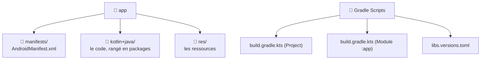

---
tags:
  - projet/kotlin
  - type/concept
  - techno/kotlin
  - techno/android
  - sujet/architecture
  - sujet/build
  - statut/a-jour
cours: P1
cree: 2026-10-26
maj: 2026-10-26
---

# Organisation d'un projet Android

> [!abstract] En une phrase
> Un projet Android, c'est **un module `app`** qui contient 3 choses : le **manifest**, le **code** (rangé en packages) et les **ressources**, plus les **fichiers Gradle** autour. À lire après [[00 les composant de base]].

> [!note] Complété le 26 octobre 2026
> Note ajoutée à partir de la grille d'évaluation (critère « organisation des dossiers »). Les exemples viennent du projet **Metrix**.

---

## 🗂️ Ce qu'on voit dans Android Studio (vue Android)



| Dossier | Ce qu'il contient | Note |
|---|---|---|
| `manifests/` | La **carte d'identité** de l'app | [[01 Le manifest]] |
| `kotlin+java/com.diiage.metrix` | Le **code** de l'app | ci-dessous |
| `kotlin+java/… (test)` | Les **tests unitaires** (tournent sur le PC) | — |
| `kotlin+java/… (androidTest)` | Les **tests instrumentés** (tournent sur le téléphone) | — |
| `res/` | Images, strings, couleurs, thèmes… | [[04 Les Ressources]] |
| `Gradle Scripts` | Comment **fabriquer** l'app | [[01 Les fichiers Gradle]] |

> [!tip] Vue Android vs vue Project
> La vue **Android** (menu en haut à gauche de l'arborescence) **regroupe** les fichiers par rôle. La vue **Project** montre les **vrais dossiers** sur le disque : `app/src/main/java/…`, `app/src/main/res/…`, `app/src/main/AndroidManifest.xml`.

---

## 📦 Ranger le code en packages (par couche)

On ne met pas tout le code en vrac : on le **range par couche**, comme la [[00 Architecture|Clean Architecture]] le demande. Voici le vrai rangement de **Metrix** :

```text
com.diiage.metrix
├── MainActivity.kt          ← la seule Activity (Single Activity)
├── MetrixApplication.kt     ← démarre Koin
├── di/                      ← AppModule.kt : le câblage Koin
├── domain/                  ← le MÉTIER (pur Kotlin)
│   ├── model/               ← Host, Alert, User…
│   ├── repository/          ← les interfaces (IHostRep…)
│   └── usecase/
├── data/                    ← d'où viennent les données
│   ├── dto/                 ← la forme du JSON de l'API
│   ├── remote/              ← les appels HTTP (Ktor)
│   ├── local/               ← le stockage sur le téléphone
│   ├── mapper/              ← DTO → modèle du domaine
│   └── repository/          ← les implémentations (HostRepo…)
└── ui/                      ← l'AFFICHAGE
    ├── core/                ← thème, NavHost, composants réutilisables
    └── screens/             ← un dossier par écran (Screen + ViewModel)
```

| Package | Pourquoi |
|---|---|
| `domain/` | Le **cœur** : ce que l'app manipule. Il ne dépend de **rien d'autre** → [[01 La couche Domain]] |
| `data/` | **Va chercher** et **stocke** les données → [[02 La couche Data]] |
| `ui/` | **Affiche** et réagit aux clics → [[03 La couche UI (MVI et UDF)]] |
| `di/` | **Branche** les couches entre elles avec [[09 Koin (injection de dépendances)\|Koin]] |
| `ui/screens/hostList/` | **Un dossier par écran** : on trouve le `Screen` et son `ViewModel` au même endroit |

> [!success] Ce que la grille regarde
> « Les **composants sont placés au bon endroit** » et « le code est intégré de manière **indifférenciée** » : un nouvel écran doit ressembler aux autres (même dossier, mêmes noms, même découpage).

---

## 🚫 Ce qu'on ne commite pas

| Dossier / fichier | Pourquoi |
|---|---|
| `build/` | **Généré** à chaque build (APK, classes compilées) |
| `.gradle/`, `.idea/` | Caches de Gradle et d'Android Studio |
| `local.properties` | Le chemin du SDK **sur ta machine** → [[01 Les fichiers Gradle]] |

---

## 🔗 Liens

- [[00 les composant de base]]
- [[00 Architecture]] — pourquoi on range par couche
- [[01 Les fichiers Gradle]] — le détail des fichiers Gradle
