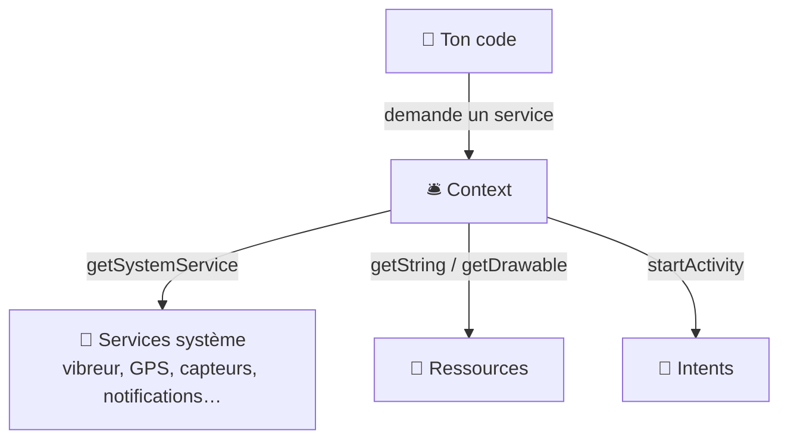
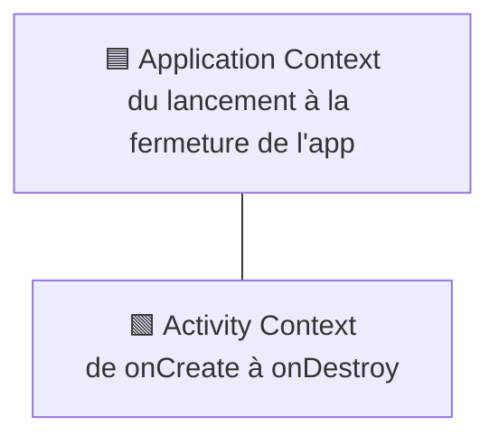

---
tags:
  - projet/kotlin
  - type/concept
  - techno/kotlin
  - techno/android
  - techno/koin
  - sujet/context
  - sujet/capacites-natives
  - statut/a-jour
cours: P1
cree: 2026-10-26
maj: 2026-10-26
---

# Le Context

> [!abstract] En une phrase
> Le **Context** est l'**intermédiaire** entre ton app et le **système Android** : c'est lui qu'on appelle pour avoir une ressource, lancer une activity ou parler au matériel (vibreur, GPS, capteurs…). La définition de base est dans [[02 Les Activities#Le contexte]].

> [!note] Complété le 26 octobre 2026
> Note ajoutée à partir de la grille d'évaluation (« le rôle central du Context, **médiateur** entre l'application et les services système »). À comparer avec le cours.

---

## 🛎️ Le Context = le guichet du système

> [!example] Le guichet
> Ton code n'a **pas le droit** de toucher directement au vibreur ou au GPS. Il passe par un **guichet** : le **Context**. Tu demandes « je voudrais le service vibreur », le guichet vérifie et te **donne le service**.



Ce que le Context permet :

| Besoin | Appel | Note |
|---|---|---|
| Un **service matériel** | `context.getSystemService(SensorManager::class.java)` | [[12 Les capacités natives (Managers)]] |
| Une **ressource** | `context.getString(R.string.app_name)` | [[03 Les Ressources]] |
| Ouvrir une **activity** | `context.startActivity(intent)` | [[10 Les Intents]] |
| Vérifier une **permission** | `ContextCompat.checkSelfPermission(context, …)` | [[05 Les Permissions]] |
| Des **fichiers** privés de l'app | `context.filesDir` | — |

---

## 👥 Les deux Contexts à connaître

Il n'y a pas **un** Context mais **plusieurs**, qui ne vivent **pas aussi longtemps** :

| Context | Vit… | Sert à |
|---|---|---|
| **Application** (`applicationContext`) | **Tant que l'app tourne** | Les services longue durée : Koin, base de données, Managers |
| **Activity** (l'activity elle-même) | **Tant que l'activity vit** ([[02 Les Activities#Le cycle de vie d'une Activity\|cycle de vie]]) | Tout ce qui touche à **l'écran** : thème, dialogues, demande de permission |



> [!warning] Le piège : la fuite de mémoire
> Si un objet qui vit **longtemps** (un `single` Koin, un ViewModel) garde l'**Activity Context**, l'activity ne peut **jamais être libérée**, même après `onDestroy` : c'est une **fuite de mémoire** (*memory leak*).
> ✅ Pour un objet longue durée, on lui donne l'**Application Context**.

> [!question] À confirmer avec le cours
> Ta note [[01 Le manifest#Point d'attention injection de dépendances]] dit que les dépendances injectées « font tuer les activities ». La règle qu'on trouve dans la doc Android est celle du dessus : **ne jamais garder un Activity Context dans un objet injecté qui vit plus longtemps que l'activity**. Vérifie si c'est ça que le prof voulait dire.

---

## 🧩 Où trouver un Context

| Endroit | Comment |
|---|---|
| Dans une **Activity** | `this` (une activity **est** un Context) |
| Dans un **composable** | `val context = LocalContext.current` |
| Dans un **module Koin** | `androidContext()` → c'est l'**Application Context** |
| Dans un **ViewModel** | ❌ **Pas de Context.** On lui injecte plutôt un **Manager** qui en a un |

Exemple réel, **Metrix** (`di/AppModule.kt`) :

```kotlin
single<TokenStorage> { AndroidTokenStorage(androidContext()) }
```

| Code | Pourquoi |
|---|---|
| `androidContext()` | Koin donne l'**Application Context**, déclaré au démarrage dans `MetrixApplication` (`androidContext(this@MetrixApplication)`) |
| `single` | Le stockage vit **toute la vie de l'app** → il lui faut un Context qui vit aussi longtemps |

> [!tip] Pourquoi pas de Context dans le ViewModel ?
> Le ViewModel **survit** à la rotation de l'écran, alors que l'activity est **recréée**. S'il gardait l'ancienne activity, ce serait une fuite. Et le ViewModel deviendrait **dur à tester**. Le Context reste donc dans les **Managers** (couche Data), jamais dans le **ViewModel**.

---

## 🔗 Liens

- [[02 Les Activities]] — la définition de base du contexte
- [[12 Les capacités natives (Managers)]] — le Context au service du matériel
- [[05 Les fonctions d'extension]] — ajouter ses propres fonctions au Context
- [[08 Koin (injection de dépendances)]] — `androidContext()`
