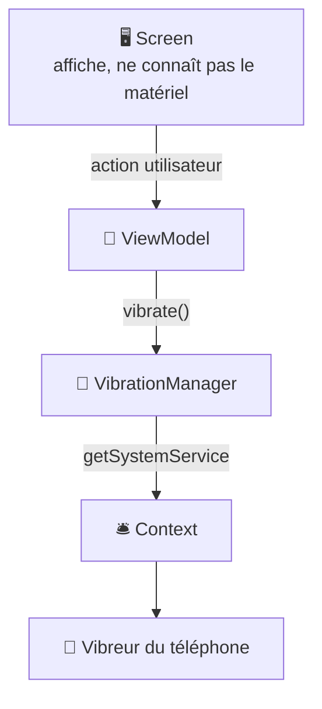

---
tags:
  - projet/kotlin
  - type/guide
  - techno/kotlin
  - techno/android
  - techno/koin
  - sujet/capacites-natives
  - sujet/context
  - sujet/permissions
  - sujet/architecture
  - statut/a-jour
cours: P1
cree: 2026-10-26
maj: 2026-10-26
---

# Les capacités natives et les Managers

> [!abstract] En une phrase
> Pour utiliser le **matériel** du téléphone (vibreur, son, GPS, capteurs, caméra…), on passe par le [[12 Le Context|Context]], et on **range tout ce code dans un Manager** : une classe dédiée, pour que l'**UI ne sache rien du matériel**.

> [!note] Complété le 26 octobre 2026
> Note ajoutée à partir de la grille d'évaluation (critères « capacités natives » : théorie **et** pratique). Exemples écrits pour la note, pas tirés de Metrix (Metrix n'a pas encore de Manager).

---

## 📱 Les capacités natives

Une **capacité native**, c'est une fonction **matérielle** du téléphone. Chacune a un **service système**, qu'on obtient par le Context :

| Capacité | Service Android | Permission | Type de permission |
|---|---|---|---|
| **Vibreur** | `Vibrator` / `VibratorManager` | `VIBRATE` | normale (pas de popup) |
| **Son** | `MediaPlayer`, `SoundPool` | aucune | — |
| **Capteurs** (gyroscope, accéléromètre…) | `SensorManager` | aucune | — |
| **GPS** | `LocationManager` ou `FusedLocationProviderClient` | `ACCESS_FINE_LOCATION` | **dangereuse** (popup) |
| **Caméra** | `CameraX` | `CAMERA` | **dangereuse** (popup) |
| **Notifications** | `NotificationManager` | `POST_NOTIFICATIONS` | **dangereuse** (Android 13+) |
| **Base de données** | Room (SQLite) | aucune | — |

> [!info] Les vrais mots
> Les permissions « simples » de [[06 Les Permissions]] s'appellent des **permissions normales** : accordées **à l'installation**. Les « invasives » s'appellent des **permissions dangereuses** : il faut les **déclarer** dans le manifest **et** les **demander à l'exécution** (la popup).

---

## 🧰 Le problème : le matériel dans l'écran

> [!failure] Ce que la grille sanctionne
> « Le code d'accès aux fonctionnalités natives est **mélangé avec du code d'affichage**. » Exemple : un composable qui fait lui-même `getSystemService(...)` et `vibrate(...)`.

Pourquoi c'est un problème :
- l'écran devient **long** et **dur à lire** ;
- impossible de **réutiliser** la vibration ailleurs sans copier-coller ;
- impossible de faire une **preview** ou un **test** (pas de vrai téléphone).

---

## 🧩 La solution : un Manager par capacité

> [!example] Le technicien
> Le **Manager**, c'est le **technicien** du vibreur. L'écran ne sait pas comment marche un vibreur : il dit juste au ViewModel « il y a une alerte », le ViewModel dit au technicien « vibre », et c'est le technicien qui parle au Context.



### Exemple 1 : le vibreur

```kotlin
/**
 * Fait vibrer le téléphone.
 *
 * Toute la logique du vibreur est ici : le ViewModel appelle juste [vibrate].
 * Nécessite `<uses-permission android:name="android.permission.VIBRATE" />` dans le manifest.
 *
 * @param context l'Application Context, fourni par Koin avec `androidContext()`.
 */
class VibrationManager(context: Context) {

    private val vibrator: Vibrator? =
        if (Build.VERSION.SDK_INT >= Build.VERSION_CODES.S) {
            context.getSystemService(VibratorManager::class.java)?.defaultVibrator
        } else {
            context.getSystemService(Vibrator::class.java)
        }

    /** Vibre pendant [durationMs] millisecondes. Ne fait rien si le téléphone n'a pas de vibreur. */
    fun vibrate(durationMs: Long = 200) {
        val effect = VibrationEffect.createOneShot(durationMs, VibrationEffect.DEFAULT_AMPLITUDE)
        vibrator?.vibrate(effect)
    }
}
```

| Code | Pourquoi |
|---|---|
| `class VibrationManager(context: Context)` | Le Manager **reçoit** le Context, il ne le cherche pas lui-même → [[09 Koin (injection de dépendances)\|Koin]] le lui donne |
| `Build.VERSION.SDK_INT >= …S` | Depuis **Android 12** (API 31), on passe par `VibratorManager`. Avant, par `Vibrator` |
| `getSystemService(...)` | On demande le **service** au guichet (le Context) |
| `Vibrator?` + `vibrator?.` | Le service peut être **absent** (tablette sans vibreur) : pas de crash |
| `VibrationEffect.createOneShot` | **Une** vibration, d'une durée donnée |

### Exemple 2 : le gyroscope (un capteur)

```kotlin
/**
 * Lit le gyroscope et publie sa vitesse de rotation.
 *
 * Un capteur allumé vide la batterie : on appelle [start] quand l'écran est
 * visible et [stop] quand il ne l'est plus (voir « 03 Le cycle de vie »).
 *
 * @param context l'Application Context, fourni par Koin.
 */
class GyroscopeManager(context: Context) : SensorEventListener {

    private val sensorManager = context.getSystemService(SensorManager::class.java)
    private val gyroscope: Sensor? = sensorManager?.getDefaultSensor(Sensor.TYPE_GYROSCOPE)

    private val _rotationZ = MutableStateFlow(0f)

    /** Vitesse de rotation autour de l'axe Z, en radians par seconde. */
    val rotationZ: StateFlow<Float> = _rotationZ.asStateFlow()

    /** Commence à écouter le capteur. Sans effet si le téléphone n'a pas de gyroscope. */
    fun start() {
        gyroscope?.let { sensorManager?.registerListener(this, it, SensorManager.SENSOR_DELAY_UI) }
    }

    /** Arrête d'écouter le capteur, pour économiser la batterie. */
    fun stop() {
        sensorManager?.unregisterListener(this)
    }

    override fun onSensorChanged(event: SensorEvent?) {
        _rotationZ.value = event?.values?.get(2) ?: return
    }

    override fun onAccuracyChanged(sensor: Sensor?, accuracy: Int) = Unit
}
```

| Code | Pourquoi |
|---|---|
| `: SensorEventListener` | Le Manager **écoute** le capteur : Android l'appelle à chaque nouvelle mesure |
| `getDefaultSensor(Sensor.TYPE_GYROSCOPE)` | On choisit **quel** capteur. `null` si le téléphone n'en a pas |
| `MutableStateFlow` privé + `StateFlow` public | Le Manager **publie** la valeur, le ViewModel la **lit** sans pouvoir la modifier |
| `SENSOR_DELAY_UI` | Une fréquence suffisante pour l'affichage, et **économe** |
| `start()` / `stop()` | On allume et on éteint le capteur **au bon moment** du cycle de vie → [[03 Le cycle de vie]] |

### Exemple 3 : jouer un son

```kotlin
/**
 * Joue les sons courts de l'app (fichiers de `res/raw`).
 *
 * @property context l'Application Context, fourni par Koin.
 */
class SoundManager(private val context: Context) {

    /** Joue [soundRes], puis libère le lecteur à la fin du son. */
    fun play(@RawRes soundRes: Int) {
        MediaPlayer.create(context, soundRes)?.apply {
            setOnCompletionListener { it.release() }
            start()
        }
    }
}
```

| Code | Pourquoi |
|---|---|
| `@RawRes soundRes: Int` | On reçoit l'**identifiant** d'un son rangé dans `res/raw/` (ex. `R.raw.bip`) |
| `MediaPlayer.create(...)?` | Peut renvoyer `null` si le fichier est illisible : pas de crash |
| `setOnCompletionListener { it.release() }` | **Libère** le lecteur à la fin, sinon il garde de la mémoire |

---

## 🔌 Brancher un Manager

### Dans Koin

```kotlin
val appModule = module {
    single { VibrationManager(androidContext()) }
    single { GyroscopeManager(androidContext()) }
    single { SoundManager(androidContext()) }
    viewModelOf(::AlertViewModel)
}
```

| Code | Pourquoi |
|---|---|
| `single` | **Un seul** Manager pour toute l'app : il n'y a qu'un vibreur |
| `androidContext()` | L'**Application Context**, qui vit aussi longtemps que le `single` → pas de fuite ([[12 Le Context]]) |

### Dans le ViewModel

```kotlin
class AlertViewModel(
    private val vibrationManager: VibrationManager,
) : ViewModel() {

    /** Une nouvelle alerte est arrivée : on prévient l'utilisateur. */
    fun onNewAlert() {
        vibrationManager.vibrate()
    }
}
```

👉 Le **Screen** n'importe **rien** de `android.hardware` ou `android.os.Vibrator`. Il appelle juste `viewModel.onNewAlert()`.

---

## 🔐 Demander une permission dangereuse

Pour le GPS ou la caméra : **1)** la déclarer dans le manifest, **2)** la demander à l'exécution.

```xml
<!-- Position précise : pour afficher l'utilisateur sur la carte -->
<uses-permission android:name="android.permission.ACCESS_FINE_LOCATION" />
<uses-permission android:name="android.permission.ACCESS_COARSE_LOCATION" />
```

```kotlin
@Composable
fun MapScreen(viewModel: MapViewModel = koinViewModel()) {
    val launcher = rememberLauncherForActivityResult(
        ActivityResultContracts.RequestPermission()
    ) { granted -> viewModel.onLocationPermissionResult(granted) }

    Button(onClick = { launcher.launch(Manifest.permission.ACCESS_FINE_LOCATION) }) {
        Text(stringResource(R.string.map_locate_me))
    }
}
```

| Code | Pourquoi |
|---|---|
| `rememberLauncherForActivityResult(RequestPermission())` | Prépare la **popup** de permission. Le bloc `{ granted -> }` reçoit la **réponse** |
| `launcher.launch(...)` | **Affiche** la popup (ou répond direct si c'est déjà accordé / refusé) |
| `viewModel.onLocationPermissionResult(granted)` | L'écran **remonte** la réponse au ViewModel : c'est lui qui décide quoi faire |

> [!tip] Déjà fait dans le cours
> La même mécanique, pour les notifications, est expliquée pas à pas dans [[4.1 Notifications push côté Kotlin]] (étape 3).

---

## ✅ Ce que la grille attend (SF-6 et SE-5)

> [!success] Pour viser « Maîtrisé »
> - Au moins **2 capacités natives** (son, vibreur, GPS, gyroscope, base de données…).
> - L'accès au matériel est **centralisé dans des Managers**, **détaché de l'UI**.
> - Au moins **une fonction d'extension sur `Context`** → [[05 Les fonctions d'extension]].
> - Les Managers ont des **commentaires clairs** (KDoc) → [[06 KDoc et commentaires]].

---

## 🔗 Liens

- [[12 Le Context]] — le guichet vers le matériel
- [[06 Les Permissions]] — déclarer avant d'utiliser
- [[03 Le cycle de vie]] — allumer et éteindre un capteur au bon moment
- [[05 Les fonctions d'extension]] — `Context.hasPermission()`
