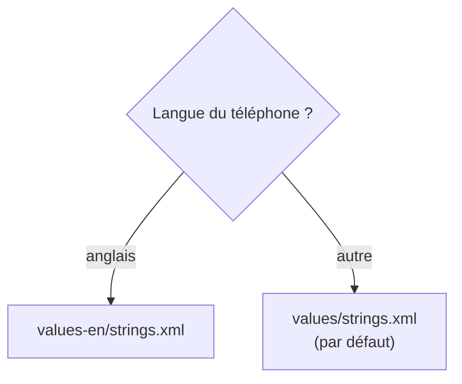

---
tags:
  - projet/kotlin
  - type/guide
  - techno/kotlin
  - techno/android
  - techno/compose
  - sujet/ressources
  - sujet/conventions
  - statut/a-jour
cours: P1
cree: 2026-10-26
maj: 2026-10-26
---

# Les ressources en pratique

> [!abstract] En une phrase
> Comment **utiliser** les ressources dans le code, créer une **variante** (une autre langue, le mode nuit) et les **nommer** proprement. La théorie est dans [[03 Les Ressources]].

> [!note] Complété le 26 octobre 2026
> Note ajoutée à partir de la grille d'évaluation : « utilisation **systématique** des ressources et **au moins une variante** de ressource (dark mode, langue différente…) » et « le **nommage** des ressources suit une **convention** ».

---

## 🗂️ Les dossiers de `res`

| Dossier | Contient | Exemple |
|---|---|---|
| `values/` | Textes, couleurs, dimensions, thèmes (en XML) | `strings.xml`, `colors.xml` |
| `drawable/` | Images et icônes | `ic_hosts.xml` |
| `mipmap-*/` | **L'icône de l'app** uniquement, en plusieurs tailles | `ic_launcher` |
| `raw/` | Fichiers gardés **tels quels** (sons, vidéos) | `bip.mp3` |
| `xml/` | Fichiers de config XML | `network_security_config.xml` |

---

## ✍️ Utiliser une ressource

Chaque ressource reçoit un **identifiant** dans la classe générée **`R`** : `R.string.app_name`, `R.drawable.ic_hosts`…

```kotlin
// Dans un composable
Text(text = stringResource(R.string.host_list_title))
Icon(painter = painterResource(R.drawable.ic_hosts), contentDescription = null)

// Avec un trou à remplir : <string name="welcome">Bonjour %1$s !</string>
Text(text = stringResource(R.string.welcome, userName))
```

| Code | Pourquoi |
|---|---|
| `stringResource(R.string.…)` | Va chercher le texte **dans la bonne langue** |
| `painterResource(R.drawable.…)` | Charge une image ou une icône |
| `%1$s` | Un **trou** dans le texte, rempli par le 2e argument |

> [!failure] À éviter : le texte en dur
> `Text("Liste des hôtes")` marche, mais le texte ne sera **jamais traduit** et la grille demande une utilisation **systématique** des ressources. Tout texte visible va dans `strings.xml`.

### Et dans un ViewModel (sans Context) ?

Le ViewModel n'a **pas de Context** ([[11 Le Context]]), donc pas de `getString`. On lui fait garder l'**identifiant**, et c'est l'écran qui le traduit. Vrai code de **Metrix** :

```kotlin
data class HostListUiState(
    // …
    @StringRes val errorMessage: Int? = null,
)

// Dans le ViewModel
errorMessage = exception.apiErrorMessage(R.string.host_list_load_error)

// Dans l'écran (HostListScreen.kt)
text = stringResource(state.errorMessage),
```

| Code | Pourquoi |
|---|---|
| `@StringRes val errorMessage: Int?` | L'état garde un **identifiant** de texte, pas le texte. `@StringRes` empêche d'y mettre n'importe quel `Int` |
| `stringResource(state.errorMessage)` | L'**écran** transforme l'identifiant en texte, dans la langue du téléphone |

---

## 🌍 Créer une variante : une autre langue

Une **variante**, c'est le **même fichier** dans un dossier avec un **qualificatif** (*qualifier*). Android choisit tout seul le bon dossier selon le téléphone.



Étapes :

1. Clic droit sur **`res`** → **New → Android Resource File**.
2. **File name** : `strings` ; **Resource type** : `Values`.
3. Dans **Available qualifiers**, choisir **Locale** → **>>** → choisir la langue (ex. `en`).
4. Recopier les `<string>` en gardant **les mêmes `name`** et traduire le texte.

```xml
<!-- res/values/strings.xml : langue par défaut (français) -->
<resources>
    <string name="host_list_title">Hôtes</string>
</resources>

<!-- res/values-en/strings.xml : utilisé si le téléphone est en anglais -->
<resources>
    <string name="host_list_title">Hosts</string>
</resources>
```

> [!tip] L'éditeur de traductions
> Ouvre `strings.xml` → **Open editor** (en haut à droite) : le **Translations Editor** montre toutes les langues en tableau et signale en rouge les textes **non traduits**.

> [!warning] `values/` doit tout contenir
> Le dossier **sans qualificatif** est le **filet de sécurité**. Une `string` qui n'existe que dans `values-en/` fait **planter** l'app sur un téléphone en français.

---

## 🌙 Créer une variante : le mode nuit

Même principe avec le qualificatif **Night Mode** → dossier **`values-night/`** :

```xml
<!-- res/values/colors.xml -->
<color name="card_background">#FFFFFFFF</color>

<!-- res/values-night/colors.xml : utilisé en mode nuit -->
<color name="card_background">#FF1E1E1E</color>
```

```kotlin
Card(colors = CardDefaults.cardColors(containerColor = colorResource(R.color.card_background))) { … }
```

> [!note] Et le thème Compose ?
> Le template Android Studio fait aussi le mode nuit en Kotlin : `MonTheme(darkTheme = isSystemInDarkTheme())` choisit `darkColorScheme` ou `lightColorScheme`. C'est bien, mais ce n'est **pas une variante de ressource**. Pour la grille, une variante **dans `res/`** (langue ou `values-night`) est plus sûre.

---

## 🏷️ Nommer les ressources

> [!warning] Règle obligatoire
> Un nom de fichier de ressource : **minuscules, chiffres et `_` seulement**. `MonIcone.png` ou `mon-icone.png` **cassent le build**.

Une convention courante (celle que suit déjà Metrix) :

| Ressource | Convention | Exemple |
|---|---|---|
| Icône | `ic_<nom>` | `ic_hosts`, `ic_alerts` (Metrix) |
| Image | `img_<nom>` | `img_logo` |
| Fond | `bg_<nom>` | `bg_card` |
| Son | `sound_<nom>` | `sound_alert` |
| Texte | `<écran>_<élément>_<rôle>` | `host_list_load_error` (Metrix) |
| Couleur | Par **rôle**, pas par valeur | `card_background` plutôt que `grey_200` |

---

## 🔗 Liens

- [[03 Les Ressources]] — la théorie : `res`, ressources conditionnelles, reconfiguration
- [[11 Le Context]] — pourquoi le ViewModel garde un `@StringRes`
- [[07 Conventions de nommage et Lint]] — les conventions côté code
