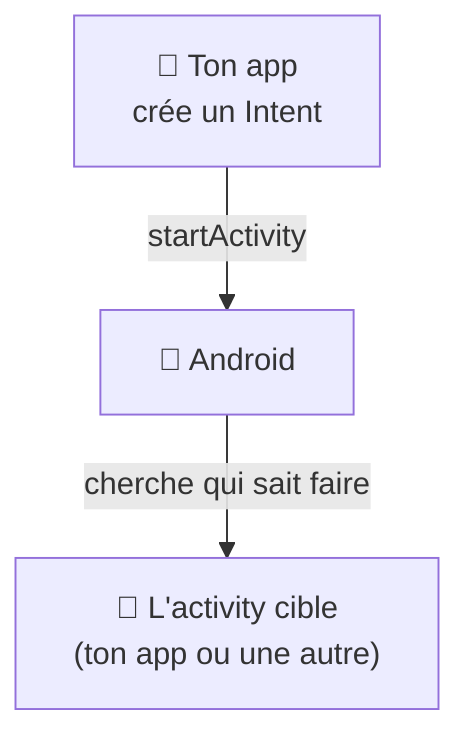

---
tags:
  - projet/kotlin
  - type/concept
  - techno/kotlin
  - techno/android
  - sujet/intent
  - sujet/activity
  - sujet/navigation
  - statut/a-jour
cours: P1
cree: 2026-10-26
maj: 2026-10-26
---

# Les Intents

> [!abstract] En une phrase
> Un **Intent**, c'est un **message** qu'on envoie au système Android pour dire « **je veux faire ça** » : ouvrir une activity, ouvrir une page web, partager un texte… À lire après [[02 Les Activities]].

> [!note] Complété le 26 octobre 2026
> Note ajoutée à partir de la grille d'évaluation (critère « Activity, Context **et Intent** »). Pas tirée de tes notes de cours : à comparer avec le cours.

---

## 💌 L'idée : une lettre adressée au système

> [!example] La lettre
> Tu ne vas pas ouvrir l'appli Chrome toi-même : tu **écris une lettre** (« ouvre cette adresse ») et tu la donnes à **Android**. Android regarde **qui sait faire ça** et lui transmet la lettre.



Il y a **deux sortes** d'Intent :

| Sorte | On dit… | Exemple |
|---|---|---|
| **Explicite** | **Qui** doit le faire (on nomme la classe) | Ouvrir `DetailActivity` de ta propre app |
| **Implicite** | **Quoi** faire, sans dire qui | « Ouvre cette URL », « Partage ce texte », « Appelle ce numéro » |

---

## 🎯 Intent explicite

```kotlin
// Envoyer
val intent = Intent(context, DetailActivity::class.java).apply {
    putExtra("hostId", 42)
}
context.startActivity(intent)

// Recevoir, dans DetailActivity
val hostId = intent.getIntExtra("hostId", -1)
```

| Code | Pourquoi |
|---|---|
| `Intent(context, DetailActivity::class.java)` | On **nomme** l'activity à ouvrir. Il faut un [[01 Le Context\|Context]] |
| `putExtra("hostId", 42)` | On **glisse une donnée** dans la lettre (un **extra**) |
| `startActivity(intent)` | On **poste** la lettre à Android |
| `getIntExtra("hostId", -1)` | On **lit** l'extra. `-1` = valeur par défaut s'il n'y est pas |

---

## 🌍 Intent implicite

```kotlin
// Ouvrir une page web
val intent = Intent(Intent.ACTION_VIEW, "https://diiage.org".toUri())
context.startActivity(intent)

// Partager un texte
val share = Intent(Intent.ACTION_SEND).apply {
    type = "text/plain"
    putExtra(Intent.EXTRA_TEXT, "Regarde ça !")
}
context.startActivity(Intent.createChooser(share, null))
```

| Code | Pourquoi |
|---|---|
| `Intent.ACTION_VIEW` | L'**action** : « affiche ça ». Android choisit l'app (le navigateur) |
| `.toUri()` | Transforme le texte en adresse (`Uri`) |
| `Intent.ACTION_SEND` + `type` | « Partage ce contenu de ce type ». Android liste les apps capables |
| `createChooser` | Affiche la **liste des apps** pour que l'utilisateur choisisse |

> [!warning] Aucune app ne sait faire ?
> Si aucune app ne répond à l'Intent implicite, `startActivity` **plante** (`ActivityNotFoundException`). Entoure l'appel d'un `try / catch`.

---

## 📄 Le lien avec le manifest

C'est un **Intent** qui lance ton app quand on touche son icône. Le [[01 Le manifest|manifest]] déclare quelle activity le reçoit, avec un **`intent-filter`** :

```xml
<activity
    android:name=".MainActivity"
    android:exported="true">
    <!-- Point d'entrée : l'activity ouverte quand on touche l'icône -->
    <intent-filter>
        <action android:name="android.intent.action.MAIN" />
        <category android:name="android.intent.category.LAUNCHER" />
    </intent-filter>
</activity>
```

| Code | Pourquoi |
|---|---|
| `action.MAIN` | « C'est le **point d'entrée** de l'app » |
| `category.LAUNCHER` | « Mets une **icône** dans le lanceur du téléphone » |
| `android:exported="true"` | D'autres apps (le lanceur) ont le **droit** de l'ouvrir. **Obligatoire** dès qu'il y a un `intent-filter` |

---

## 🧭 Et avec Compose (Single Activity) ?

Dans une app Compose, il n'y a **qu'une seule activity** (`MainActivity`) : on change d'écran avec le **NavHost**, pas avec des Intents → [[04 MainActivity]].

Les Intents servent encore pour :
- **lancer** l'app (le `intent-filter` ci-dessus) ;
- parler **aux autres apps** (navigateur, partage, téléphone, appareil photo) ;
- ouvrir l'app depuis une **notification** (un `PendingIntent`) → [[1.1 Notifications push côté Kotlin]].

> [!tip] PendingIntent
> Un **`PendingIntent`**, c'est un Intent **préparé à l'avance** et confié à quelqu'un d'autre (le système de notifications), qui l'enverra **plus tard**, au clic.

---

## 🔗 Liens

- [[02 Les Activities]] — ce que l'Intent ouvre
- [[01 Le Context]] — il faut un Context pour envoyer un Intent
- [[01 Le manifest]] — l'`intent-filter` de l'activity principale
- [[04 Les fonctions d'extension]] — ranger un Intent dans `Context.openUrl()`
