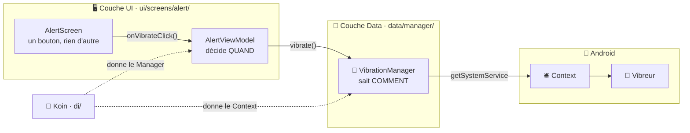

---
tags:
  - projet/kotlin
  - type/guide
  - techno/kotlin
  - techno/android
  - techno/koin
  - techno/compose
  - sujet/capacites-natives
  - sujet/permissions
  - sujet/architecture
  - statut/a-jour
cours: P1
cree: 2026-10-27
maj: 2026-10-27
---

# Le vibreur pas à pas

> [!abstract] En une phrase
> Ajouter une capacité native **de A à Z**, avec la plus simple : le **vibreur** (permission **normale**, pas de popup). On touche **5 fichiers**, dans cet ordre. La théorie est dans [[04 Les capacités natives (Managers)]].

---

## 🗺️ Qui fait quoi



> [!info] Et le Domain ?
> Le vibreur ne **produit aucune donnée** : il n'y a rien à mettre dans le Domain. Pour une capacité qui renvoie une donnée (le GPS donne une `Position`), le Domain a son modèle → [[4.2 La localisation pas à pas]].

| Qui | Il sait… | Il ne sait **pas**… |
|---|---|---|
| **Screen** | qu'il y a un bouton | qu'un vibreur existe |
| **ViewModel** | **quand** il faut vibrer | **comment** on fait vibrer |
| **Manager** | **comment** on fait vibrer | pourquoi on vibre |
| **Context** | où est le service vibreur | — |

---

## 📂 Les fichiers à toucher

```text
app/src/main/
├── AndroidManifest.xml                         ← 1. déclarer la permission
└── java/com/diiage/metrix/
    ├── data/manager/VibrationManager.kt        ← 2. le Manager (nouveau)
    ├── di/AppModule.kt                         ← 3. le brancher dans Koin
    └── ui/screens/alert/
        ├── AlertViewModel.kt                   ← 4. le ViewModel l'utilise
        └── AlertScreen.kt                      ← 5. l'écran envoie l'action
```

---

## 1️⃣ Le manifest : déclarer

```xml
<manifest xmlns:android="http://schemas.android.com/apk/res/android">

    <!-- Vibreur : faire vibrer le téléphone à chaque nouvelle alerte -->
    <uses-permission android:name="android.permission.VIBRATE" />

    <application ...>
```

| Code | Pourquoi |
|---|---|
| `<uses-permission …VIBRATE />` | Sans ça, **Android** (le gardien) bloque la vibration → [[03 Les Permissions]] |
| Le commentaire | La grille veut **un commentaire par permission** : il dit **à quoi elle sert** dans l'app |

> [!info] Permission normale
> `VIBRATE` est une permission **normale** : accordée **à l'installation**, **pas de popup**, rien à demander dans le code. Pour une permission **dangereuse** (GPS) → [[4.2 La localisation pas à pas]].

---

## 2️⃣ Le Manager : tout le matériel est ici

```kotlin
package com.diiage.metrix.data.manager

/**
 * Fait vibrer le téléphone.
 *
 * Toute la logique du vibreur est ici : le ViewModel appelle juste [vibrate].
 * Nécessite la permission `VIBRATE` dans le manifest.
 *
 * @param context l'Application Context, fourni par Koin avec `androidContext()`.
 */
class VibrationManager(context: Context) {

    private val vibrator: Vibrator? =
        if (Build.VERSION.SDK_INT >= Build.VERSION_CODES.S) {
            context.getSystemService(VibratorManager::class.java)?.defaultVibrator
        } else {
            context.getSystemService(Vibrator::class.java)
        }

    /** Vibre pendant [durationMs] millisecondes. Ne fait rien si le téléphone n'a pas de vibreur. */
    fun vibrate(durationMs: Long = 200) {
        val effect = VibrationEffect.createOneShot(durationMs, VibrationEffect.DEFAULT_AMPLITUDE)
        vibrator?.vibrate(effect)
    }
}
```

| Code | Pourquoi |
|---|---|
| `data/manager/` | Le Manager parle au **matériel**, comme un Service parle à l'API : il va dans **Data** |
| `(context: Context)` | Il **reçoit** le Context, il ne le cherche pas → c'est Koin qui le donne |
| `getSystemService(...)` | On demande le **service** au guichet → [[01 Le Context]] |
| `Build.VERSION_CODES.S` | Depuis **Android 12**, on passe par `VibratorManager`. Avant, par `Vibrator` |
| `Vibrator?` et `vibrator?.` | Une tablette peut ne **pas avoir** de vibreur : pas de crash |

---

## 3️⃣ Koin : brancher

```kotlin
val appModule = module {
    // Matériel : un seul Manager pour toute l'app, avec l'Application Context
    single { VibrationManager(androidContext()) }

    viewModelOf(::AlertViewModel)
}
```

| Code | Pourquoi |
|---|---|
| `single` | **Un seul** vibreur, donc **un seul** Manager |
| `androidContext()` | L'**Application Context** : il vit aussi longtemps que le `single` → **pas de fuite mémoire** |
| `viewModelOf(::AlertViewModel)` | Koin voit que le ViewModel veut un `VibrationManager` et le lui donne **tout seul** → [[05 Koin (injection de dépendances)]] |

---

## 4️⃣ Le ViewModel : décider quand

```kotlin
class AlertViewModel(
    private val vibrationManager: VibrationManager,
) : ViewModel() {

    /** L'utilisateur teste l'alerte : on fait vibrer le téléphone. */
    fun onVibrateClick() {
        vibrationManager.vibrate()
    }
}
```

| Code | Pourquoi |
|---|---|
| `private val vibrationManager` | Le ViewModel **reçoit** le Manager (injection), il ne le crée pas |
| `onVibrateClick()` | Une **action** au nom clair : « on a cliqué sur Vibrer » → [[04 La couche UI (MVI et UDF)]] |
| **Pas de Context** ici | Le ViewModel ne touche **jamais** au Context : c'est le Manager qui l'a |

---

## 5️⃣ L'écran : envoyer l'action

```kotlin
@Composable
fun AlertScreen(viewModel: AlertViewModel = koinViewModel()) {
    AlertContent(onVibrateClick = viewModel::onVibrateClick)
}

@Composable
fun AlertContent(onVibrateClick: () -> Unit) {
    Button(onClick = onVibrateClick) {
        Text(stringResource(R.string.alert_vibrate_button))
    }
}
```

| Code | Pourquoi |
|---|---|
| `koinViewModel()` | Koin fournit le ViewModel déjà branché |
| `viewModel::onVibrateClick` | L'écran **remonte l'action**, c'est tout (UDF) |
| `AlertContent` séparé | Le **Content** ne connaît même pas le ViewModel : on peut en faire une **preview** → [[05 Les previews]] |
| **Aucun import** `android.os.Vibrator` | C'est **le** test : si l'écran importe du matériel, c'est raté |

---

## ✅ Vérifier

> [!warning] L'émulateur ne vibre pas
> Teste sur un **vrai téléphone**. Sur l'émulateur, le code tourne sans erreur mais tu ne sens rien.

- [ ] La permission est dans le manifest, **avec son commentaire**
- [ ] `getSystemService` n'apparaît **que** dans le Manager
- [ ] Le ViewModel n'a **pas** de Context
- [ ] L'écran n'importe **rien** de `android.os` ou `android.hardware`
- [ ] Le Manager a son **KDoc** → [[05 KDoc et commentaires]]

---

## 🔗 Liens

- [[04 Les capacités natives (Managers)]] — la théorie et les autres Managers (gyroscope, son)
- [[4.2 La localisation pas à pas]] — la même chose avec une permission **dangereuse**
- [[03 Les Permissions]] — normale ou dangereuse
- [[01 Le Context]] — le guichet vers le matériel
