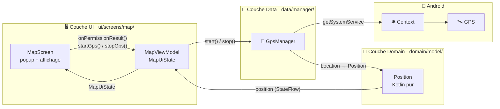
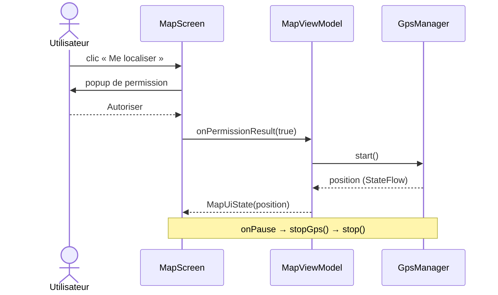

---
tags:
  - projet/kotlin
  - type/guide
  - techno/kotlin
  - techno/android
  - techno/koin
  - techno/compose
  - sujet/capacites-natives
  - sujet/permissions
  - sujet/cycle-de-vie
  - sujet/architecture
  - statut/a-jour
cours: P1
cree: 2026-10-27
maj: 2026-10-27
---

# La localisation pas à pas

> [!abstract] En une phrase
> Comme [[4.1 Le vibreur pas à pas]], mais avec une permission **dangereuse** : il faut **déclarer** dans le manifest **et** **demander** à l'utilisateur (la popup). Et comme le GPS vide la batterie, on l'**allume** et on l'**éteint** avec le [[03 Le cycle de vie|cycle de vie]].

---

## 🗺️ Qui fait quoi



> [!info] La seule chose que l'écran fait en plus
> La **popup** de permission a besoin d'une activity à l'écran : c'est **le seul** truc « Android » que le Screen a le droit de faire. Il **remonte la réponse** au ViewModel, qui décide.



---

## 📂 Les fichiers à toucher

```text
app/src/main/
├── AndroidManifest.xml                         ← 1. déclarer les 2 permissions
├── res/values/strings.xml                      ← textes de l'écran
└── java/com/diiage/metrix/
    ├── domain/model/Position.kt                ← 2. le modèle (Kotlin pur)
    ├── data/manager/GpsManager.kt              ← 3. le Manager
    ├── di/AppModule.kt                         ← 4. le brancher dans Koin
    └── ui/screens/map/
        ├── MapViewModel.kt                     ← 5. état + actions
        └── MapScreen.kt                        ← 6. popup, cycle de vie, affichage
```

---

## 1️⃣ Le manifest : déclarer

```xml
<!-- Localisation précise (GPS) : afficher la position de l'utilisateur sur la carte -->
<uses-permission android:name="android.permission.ACCESS_FINE_LOCATION" />
<!-- Localisation approximative : obligatoire avec la précise depuis Android 12 -->
<uses-permission android:name="android.permission.ACCESS_COARSE_LOCATION" />
```

> [!warning] Toujours les deux ensemble
> Depuis **Android 12**, si tu demandes `FINE` **sans** `COARSE`, Android **ignore** ta demande. Et l'utilisateur peut choisir « position **approximative** » seulement.

---

## 2️⃣ Le modèle du Domain

```kotlin
package com.diiage.metrix.domain.model

/** Une position GPS, en degrés. */
data class Position(
    val latitude: Double,
    val longitude: Double,
)
```

👉 Le `Location` d'Android **reste dans Data**. Le reste de l'app ne voit qu'une `Position`, en Kotlin pur. C'est le même **mapping** que `HostDto → Host` → [[03 La couche Data]].

---

## 3️⃣ Le Manager

```kotlin
package com.diiage.metrix.data.manager

/**
 * Suit la position de l'utilisateur et la publie dans [position].
 *
 * Le GPS vide la batterie : on appelle [start] quand l'écran est au premier plan
 * et [stop] dès qu'il ne l'est plus.
 *
 * @param context l'Application Context, fourni par Koin.
 */
class GpsManager(private val context: Context) : LocationListener {

    private val locationManager = context.getSystemService(LocationManager::class.java)

    private val _position = MutableStateFlow<Position?>(null)

    /** La dernière position connue, `null` tant qu'on n'en a pas reçu. */
    val position: StateFlow<Position?> = _position.asStateFlow()

    /** Commence à suivre la position. Ne fait rien si la permission n'est pas accordée. */
    fun start() {
        val fine = ContextCompat.checkSelfPermission(context, Manifest.permission.ACCESS_FINE_LOCATION)
        val coarse = ContextCompat.checkSelfPermission(context, Manifest.permission.ACCESS_COARSE_LOCATION)

        val provider = when {
            fine == PackageManager.PERMISSION_GRANTED -> LocationManager.GPS_PROVIDER
            coarse == PackageManager.PERMISSION_GRANTED -> LocationManager.NETWORK_PROVIDER
            else -> return
        }
        locationManager?.requestLocationUpdates(provider, 5_000L, 10f, this, Looper.getMainLooper())
    }

    /** Arrête de suivre la position, pour économiser la batterie. */
    fun stop() {
        locationManager?.removeUpdates(this)
    }

    override fun onLocationChanged(location: Location) {
        _position.value = Position(location.latitude, location.longitude)
    }
}
```

| Code | Pourquoi |
|---|---|
| `GpsManager` et pas `LocationManager` | `LocationManager` est **déjà** le nom de la classe Android : on évite la confusion |
| `: LocationListener` | Android **appelle** `onLocationChanged` à chaque nouvelle position |
| `checkSelfPermission` **dans** `start()` | Le Manager vérifie lui-même : si on l'appelle trop tôt, il **ne plante pas**, il ne fait rien |
| `GPS_PROVIDER` / `NETWORK_PROVIDER` | Précise → GPS. Approximative seulement → réseau (Wi-Fi, antennes) |
| `5_000L, 10f` | Une mise à jour **toutes les 5 s** ou **tous les 10 m** au plus : suffisant et économe |
| `Location → Position` | Le **mapping** : l'objet Android ne sort pas de Data |
| `MutableStateFlow` privé, `StateFlow` public | Le Manager **publie**, le ViewModel **lit** sans pouvoir modifier |

> [!tip] Avec ton extension
> Les deux `checkSelfPermission` peuvent devenir `context.hasPermission(...)`, ta fonction d'extension → [[04 Les fonctions d'extension]]. Lint risque alors d'afficher un warning `MissingPermission` (il ne voit pas la vérification dans l'extension) : mets `@SuppressLint("MissingPermission")` sur `start()` avec un commentaire qui dit **pourquoi**.

---

## 4️⃣ Koin

```kotlin
val appModule = module {
    // Matériel : un seul GPS pour toute l'app, avec l'Application Context
    single { GpsManager(androidContext()) }

    viewModelOf(::MapViewModel)
}
```

---

## 5️⃣ Le ViewModel : état + actions

```kotlin
/** Ce que l'écran carte affiche. */
data class MapUiState(
    val position: Position? = null,
    val permissionDenied: Boolean = false,
)

class MapViewModel(
    private val gpsManager: GpsManager,
) : ViewModel() {

    private val _uiState = MutableStateFlow(MapUiState())
    val uiState: StateFlow<MapUiState> = _uiState.asStateFlow()

    init {
        // Chaque nouvelle position du Manager met à jour l'état de l'écran.
        viewModelScope.launch {
            gpsManager.position.collect { position ->
                _uiState.update { it.copy(position = position) }
            }
        }
    }

    /** Réponse de la popup : on lance le GPS si l'utilisateur a accepté. */
    fun onPermissionResult(granted: Boolean) {
        _uiState.update { it.copy(permissionDenied = !granted) }
        if (granted) gpsManager.start()
    }

    /** L'écran passe au premier plan. */
    fun startGps() = gpsManager.start()

    /** L'écran quitte le premier plan. */
    fun stopGps() = gpsManager.stop()
}
```

| Code | Pourquoi |
|---|---|
| `MapUiState` | **Un seul** état par écran, immuable → [[04 La couche UI (MVI et UDF)]] |
| `collect { … }` dans `init` | Le ViewModel **écoute** le Manager et transforme sa position en état d'écran |
| `_uiState.update { it.copy(...) }` | On crée un **nouvel** état, on ne modifie pas l'ancien |
| `onPermissionResult` | C'est le **ViewModel** qui décide quoi faire de la réponse, pas l'écran |

---

## 6️⃣ L'écran : popup, cycle de vie, affichage

```kotlin
@Composable
fun MapScreen(viewModel: MapViewModel = koinViewModel()) {
    val state by viewModel.uiState.collectAsStateWithLifecycle()

    val permissionLauncher = rememberLauncherForActivityResult(
        ActivityResultContracts.RequestMultiplePermissions()
    ) { results -> viewModel.onPermissionResult(granted = results.values.any { it }) }

    // Cycle de vie : le GPS ne tourne que quand l'écran est au premier plan
    // (ON_RESUME) et s'arrête dès qu'il passe en arrière-plan (ON_PAUSE) :
    // un GPS allumé en arrière-plan vide la batterie.
    LifecycleResumeEffect(Unit) {
        viewModel.startGps()
        onPauseOrDispose { viewModel.stopGps() }
    }

    MapContent(
        state = state,
        onLocateClick = {
            permissionLauncher.launch(
                arrayOf(
                    Manifest.permission.ACCESS_FINE_LOCATION,
                    Manifest.permission.ACCESS_COARSE_LOCATION,
                )
            )
        },
    )
}

@Composable
fun MapContent(state: MapUiState, onLocateClick: () -> Unit) {
    Column {
        Button(onClick = onLocateClick) {
            Text(stringResource(R.string.map_locate_button))
        }
        when {
            state.permissionDenied -> Text(stringResource(R.string.map_permission_denied))
            state.position != null -> Text(
                stringResource(R.string.map_position, state.position.latitude, state.position.longitude)
            )
        }
    }
}
```

```xml
<!-- res/values/strings.xml -->
<string name="map_locate_button">Me localiser</string>
<string name="map_permission_denied">Sans la localisation, impossible de te placer sur la carte.</string>
<string name="map_position">Lat %1$.4f, Lon %2$.4f</string>
```

| Code | Pourquoi |
|---|---|
| `RequestMultiplePermissions()` | On demande **FINE et COARSE ensemble** (obligatoire depuis Android 12) |
| `results.values.any { it }` | Accordé si l'utilisateur a dit oui à **au moins une** (précise ou approximative) |
| `LifecycleResumeEffect` | Allume / éteint le GPS au bon moment → [[03 Le cycle de vie]] |
| `// Cycle de vie : …` | Le **commentaire spécifique** demandé par la grille |
| `MapContent` séparé | Il ne connaît ni le ViewModel ni le GPS : **preview** possible |
| `stringResource(R.string.map_position, …)` | **Aucun texte en dur**, et les valeurs sont glissées dans `%1$` et `%2$` → [[4.1 Les ressources en pratique]] |

---

## ✅ Vérifier

> [!tip] Tester sur l'émulateur
> L'émulateur a un faux GPS : **⋯ (Extended controls) → Location**, choisis un point sur la carte et clique **Set location**. La position doit s'afficher à l'écran.

- [ ] Les **deux** permissions sont dans le manifest, **avec commentaire**
- [ ] La popup s'affiche au clic ; « Refuser » affiche le message `map_permission_denied`
- [ ] `getSystemService` et `Location` n'apparaissent **que** dans le Manager
- [ ] Le GPS s'arrête quand on met l'app en arrière-plan (icône de localisation qui disparaît dans la barre d'état)
- [ ] Le Manager a son **KDoc**

---

## 🔗 Liens

- [[4.1 Le vibreur pas à pas]] — la version simple, sans popup
- [[04 Les capacités natives (Managers)]] — la théorie
- [[03 Les Permissions]] — normale ou dangereuse
- [[03 Le cycle de vie]] — allumer et éteindre au bon moment
- [[04 Les fonctions d'extension]] — `Context.hasPermission()`
